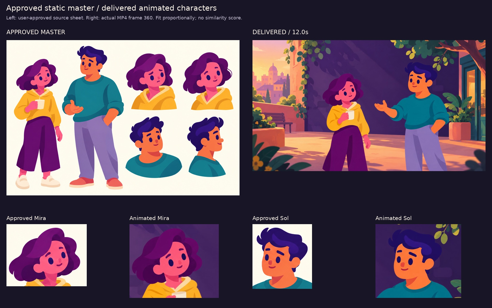
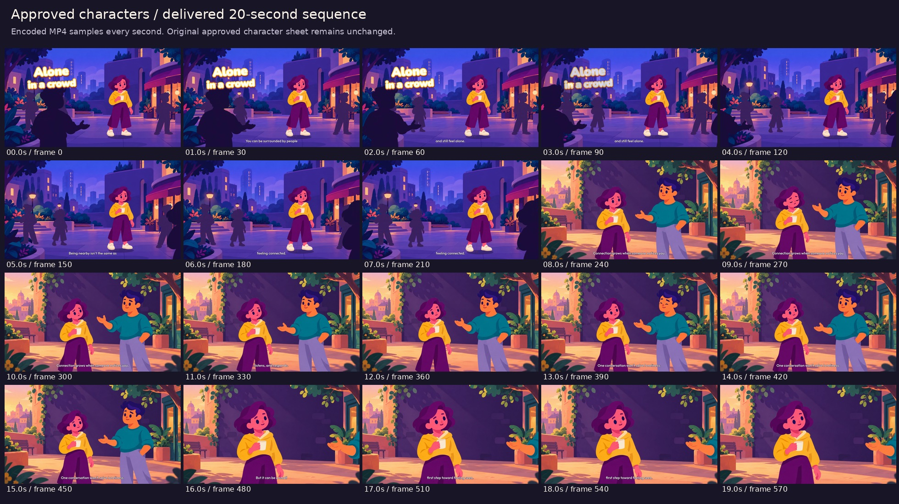
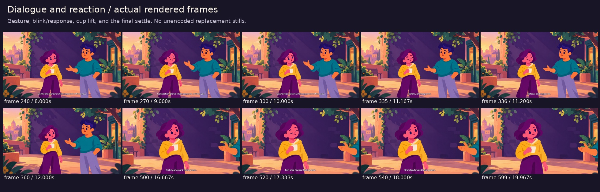
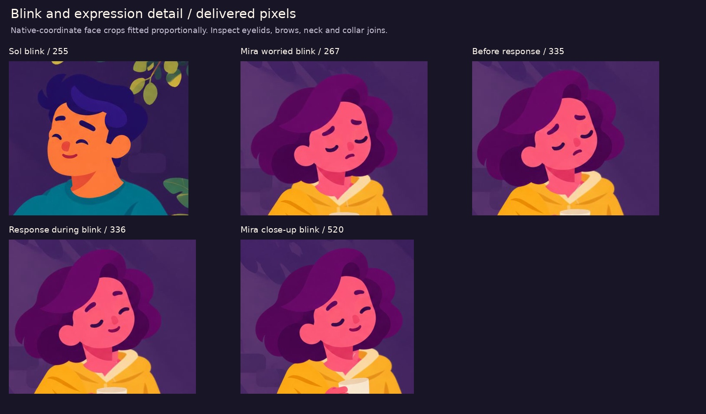

# Approved-character animation — 20-second test

The user passed this film's artwork and drawing quality. Current work focuses on [motion and narration](../../references/studies/motion-2026-10-24/README.md), with the approved art retained as the visual baseline.

[Download the MP4](https://github.com/jonaslacandola0617/odd-atom/raw/refs/heads/main/assets/videos/approved-characters-20s.mp4) · [Poster](../../assets/videos/approved-characters-20s-poster.png) · [Export verification](approved-characters/validation.json)

This test animates Mira and Sol from the [user-approved static sheet](../../assets/characters/static-test-01.png). It keeps their fuller faces, flowing plum/indigo hair, mustard hoodie, teal sweater, wide trousers, cup grip, and relaxed conversational hand. The original approved PNG is unchanged; its SHA-256 is recorded in the [asset manifest](approved-characters/assets.json).

The film is 1920 × 1080, 30 fps, and exactly 20 seconds. It uses Remotion for animation and the existing genuine ElevenLabs narration for **Alone in a crowd**, with its aligned captions, original score, and ambience. Reusing the same story and audio makes this a direct character-art test without another speech-generation request.

## Drawing continuity



Image generation adapted the approved original artwork into registered transparent parts: separate bodies, heads, arms, expressions, and eyelid variants. The generated parts retain the approved designs but are adapted drawings, not pixel-identical crops of the master. They are composited directly as illustrated cutouts; the earlier rejected vector characters are not used in this composition.

Two new original background plates match the illustration family: a twilight plaza and a warm garden terrace. Their quiet central shapes keep the faces readable. Only the story title and plain outlined narration captions appear on screen.

## Animation and staging

| Frames | Shot and action |
|---|---|
| 0–225 | Worried Mira stands apart from subdued crowd silhouettes. Foreground figures pass with their feet outside the frame, while the camera moves closer. The opening title has several outline passes and fades before the closer street view. |
| 226–461 | Mira and Sol share the terrace. Mira lifts her head; Sol makes two shoulder-driven open-palm gestures. Mira changes expression during a blink and responds with a small cup lift. |
| 462–599 | A closer reaction view emphasizes Mira's face, smile, blink, and cup movement. Sol's conversational hand remains at the right edge, connecting the shot to the interaction. |

Heads, bodies, and gesture arms have independent transforms. Small breathing and settling motions keep the poses alive. Eyelid overlays are clipped to the eye areas so a blink does not swap the entire hair silhouette. The cup and gripping hand move together; the hand is not detached from its prop.





## Inspection

The first stills were checked for identity, proportions, shoulder/neck joins, the cup grip, and background contrast before rendering the complete film. The isolated cup-arm artwork was corrected to remove an unwanted collar fragment. Encoded-frame review then identified a small eyebrow overlap during Sol's blink; the eye mask was narrowed before the final render.



Review boards and the poster are extracted from the final encoded MP4. Verification covers 600 frames, exact video/audio/container duration, full decoding, and fast-start metadata. The decoded audio hash is compared with the earlier film, confirming reuse of the same generated narration and original mix. No new listening comparison with unavailable reference episodes is claimed.

This is a limited 2D cutout rig. It supports the acting shown here; full character turnarounds, an articulated walking cycle, and phoneme lip sync are not part of this test. The foreground crowd motion is staged with legs outside the shot. Successful export checks do not substitute for judging the artwork and movement.

## Source and reproduction

- [Composition and cutout rig](../../src/ApprovedCharacters.tsx)
- [Transparent atlases and background PNGs](../../public/assets/artwork/approved-characters)
- [Approved-master and asset hashes](approved-characters/assets.json)
- [Image-generation prompts](approved-characters/prompts.json)
- [Existing ElevenLabs script and alignment](../../src/data/crowd-narration.json)
- [Encoded-frame review script](../../scripts/review_approved_characters.py)

```sh
npm ci
npm run typecheck
npm run render:approved-characters
python scripts/review_approved_characters.py
```

Select `ApprovedCharactersTest` in Remotion Studio. The committed art and audio support re-rendering without a new image-generation or speech request. Rendering uses Chromium and FFmpeg; review extraction needs Python 3 and Pillow. The previous tests remain available separately.
