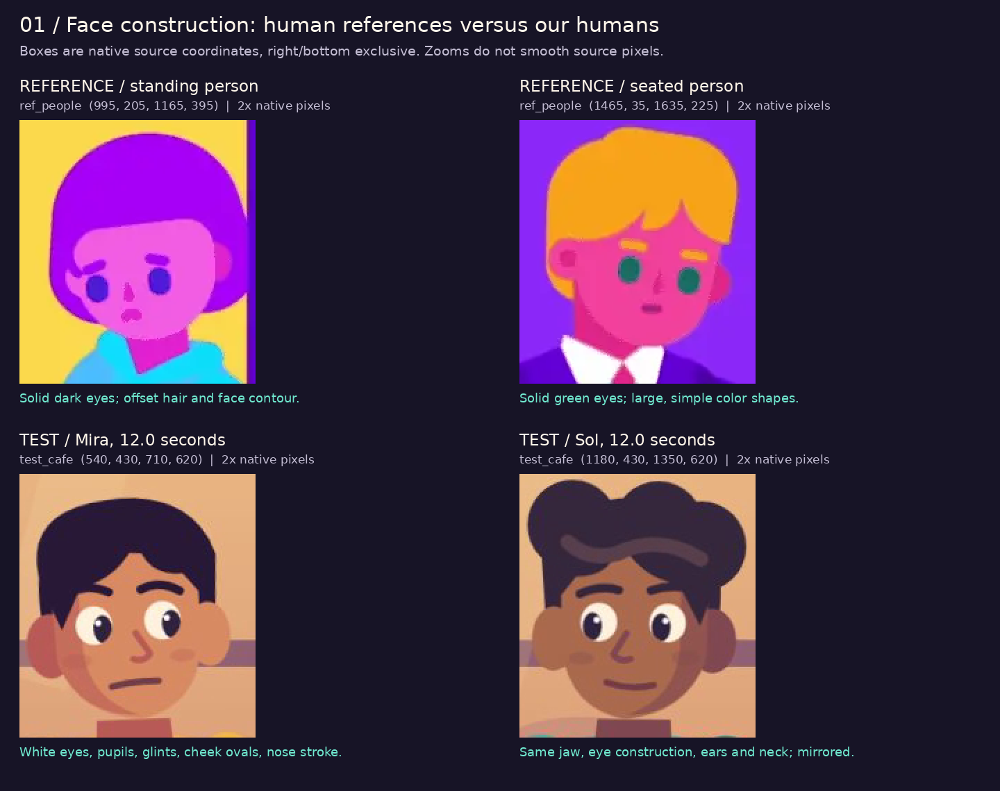
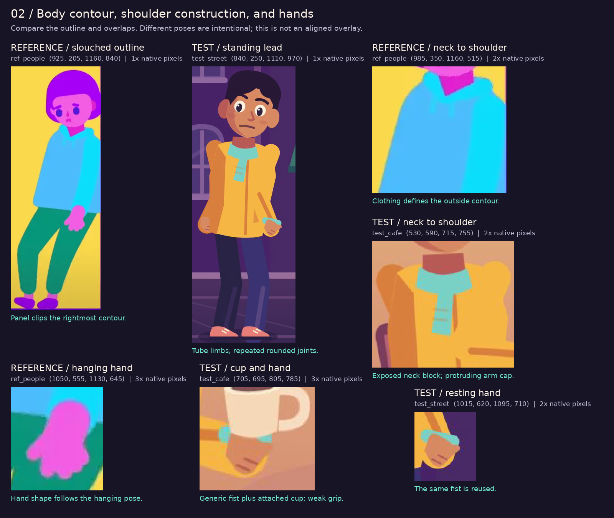
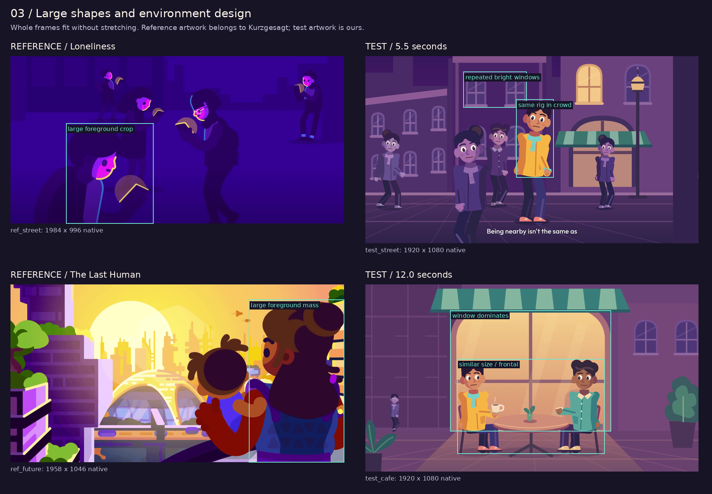
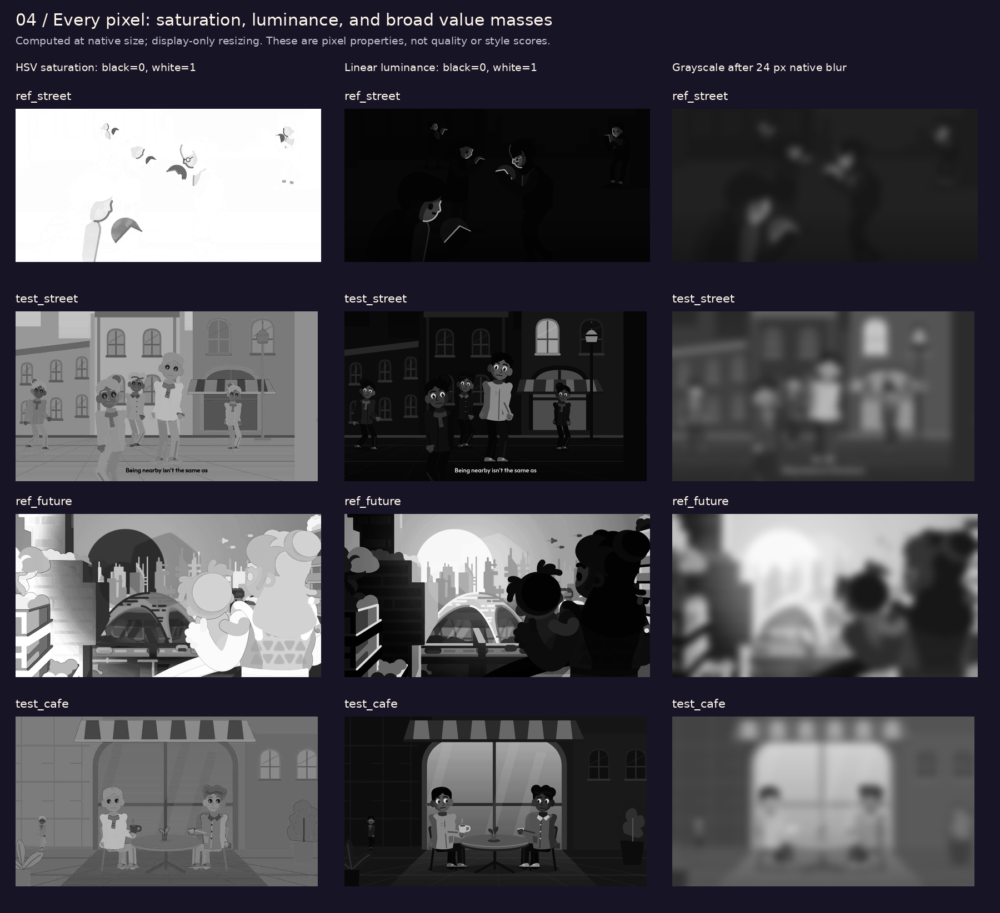
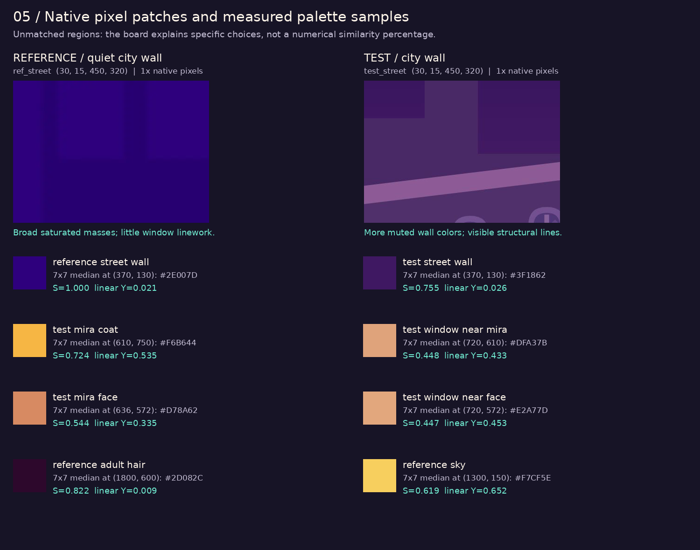

# Artwork audit: why the crowd test misses the references

**The test fails at the drawing stage.** The faces use a different visual language, the bodies expose the construction of a reusable puppet, and the setting has weak control over large shapes and contrast. More animation or a sharper export would preserve those problems. My earlier comparison was too generous and too general; listing working rig features did not establish good artwork.

This audit examines the delivered [20-second test](../../../assets/videos/alone-in-a-crowd-20s.mp4) at **5.5 s and 12.0 s**, from production commit `fb540ed5f5e714612484b9476d64f814bbd1dd91`. It compares human characters with human references from the official **Loneliness** and **The Last Human** case studies. The earlier bird-classroom comparison was a poor basis for judging our human face construction.

The reference illustrations are **Kurzgesagt's downloaded artwork**, not drawings made by this project. These are three saved official website images; they do not establish the visual rules of every episode. Full YouTube playback remains unavailable. This is an artwork audit; narration, editing, music, typography, and animation timing are outside its scope.

## Evidence at the actual pixel level

There are five boards below. Face, shoulder, hand, and wall crops show the source pixels at integer zoom, without smoothing. Every crop has its native coordinates. The diagnostic script also processes **all 10,167,284 pixels** across the five input rasters to measure saturation and linear luminance, and records exact RGB patch samples.

Different scenes cannot be meaningfully subtracted pixel for pixel: a window in one frame does not correspond to a person's face in another. No RMSE, SSIM, or invented percentage of stylistic similarity is presented. The useful comparison is to identify the specific contours, color relationships, and shape arrangements that cause the gap, supported by native crops and pixel measurements.

Coordinates start at the top left. Boxes are `(left, top, right, bottom)`, with right and bottom excluded. Full boards fit images proportionally; measurements use native rasters, not those resized displays. [All measurements and source hashes](measurements.json) are saved separately.

## 1. Faces: the first and most visible failure



| Specific drawing problem | Visible evidence | Correction for an original redesign |
|---|---|---|
| **The eyes belong to a different character design.** | The two reference humans have solid purple or green eyes. Our characters have large cream whites, dark pupils, and white glints. Those bright ovals dominate the face and produce a generic children's-cartoon appearance. | Explore simple eye shapes as part of a new face design. Judge their scale, spacing, and contrast together with the face contour. Merely deleting the whites from this head is insufficient. |
| **Both leads have the same skull and jaw.** | Mira and Sol share the exact face path, ear ellipses, eye positions, nose, and cheek marks. The curl hair and collar disguise very little of that duplication. | Give each character a distinct forehead, cheek, jaw, ear placement, and neck relationship. Make the heads distinguishable with hair and colors hidden. |
| **The head direction is largely frontal.** | Both eyes, both ears, and the central nose remain similarly presented. The right lead is a horizontal mirror of the same construction. The Loneliness street image includes actual profile contours; The Last Human presents a side/rear view with one visible eye. | Draw separate frontal, three-quarter, profile, and rear constructions. Change the outside silhouette, feature spacing, and overlap for each view. A mirrored or tilted frontal head cannot supply those views. |
| **Small marks replace stronger shape decisions.** | Our nose stroke, cheek ovals, glints, eyebrow strokes, and ear discs add separate visual pieces. The sampled reference heads organize fewer, larger colored shapes; their noses and hairlines also contribute to the contour. | Remove marks that do not explain form or expression. Allocate complexity to the hair mass, face shape, and meaningful overlaps. |
| **Facial color does little compositional work.** | Our brown skin, reddish cheek tint, and warm window sit in a related warm range. The Loneliness faces use strong pink/purple or pink/green relationships within their scene palettes. | Test palettes for the scene's emotional and focal roles. Skin can use natural or conceptual color; either needs deliberate contrast and integration with the world. |

The source confirms the eye problem quantitatively: each white eye is **17 local units wide** on a face **69 units wide**, or **24.6% of the face width per eye**. That excludes the brows, nose, and ears. The same geometry is used for both leads. This is a measurement of our drawing, not a claim that a particular eye ratio is universally correct. See [Citizen.tsx](../../../src/characters/Citizen.tsx), especially the face and eye paths.

The standing reference head has an offset bob, an uneven hairline, and a face placed asymmetrically inside the hair. Our nearly oval face, two large ear discs, and balanced eye layout remain much more regular. Changing only the palette would retain that difference.

## 2. Bodies: the rig's primitives are visible in the drawing



| Specific drawing problem | Visible evidence | Correction for an original redesign |
|---|---|---|
| **Shoulders form protruding round caps.** | In the enlarged café crop, the upper arm makes a separate rounded bump outside the coat. Both shoulders repeat this construction. | Design one coherent shoulder/sleeve contour. Place the arm attachment inside the garment and draw the overlap for the pose. |
| **The neck reads as a separate block.** | A straight-sided, dark neck segment sits between the rounded chin and scarf. The reference hoodie opening uses an angled neck and collar relationship integrated with the slouch. | Draw the chin–neck–collar junction as a connected form. Vary its angles and visible area with head and torso direction. |
| **Limbs retain uniform tube widths.** | Arms are constant-width strokes of 28 and 27 units; legs use 32-unit strokes with round joins. The reference standing figure's clothing changes contour through the shoulder, sleeve, knee, and ankle. | Draw filled sleeve and trouser shapes with purposeful taper and width changes. Treat bends and overlaps as drawings, even if animation later uses a rig underneath. |
| **The body design is reused almost unchanged.** | Leads and passersby share the torso path, limb lengths, face, and hand construction. Most differences are scale, hair, accessories, and palette. | Develop a small cast with different torso masses, shoulder slopes, limb proportions, and clothing silhouettes. Distinguish roles at thumbnail size. |
| **The pose has little emotional specificity.** | Our standing lead has a head tilt and downturned mouth, but the coat remains nearly frontal and upright. The sampled reference slouch shifts the shoulders, sleeve, knees, and weight into one connected gesture. | Begin with a line of action and weight-bearing pose. Draw the torso and clothing around it before placing facial features. |
| **The hand does not convincingly hold the cup.** | The hanging fist and cup fist share the same shape. The cup handle is to the right while the fist sits beneath the cup; the contact reads as an attachment rather than a designed grip. | Draw separate resting, gesturing, and holding hands. Show thumb/finger overlap and a credible contact point with the object. |
| **Detail stripes do not explain enough form.** | Narrow shin and forearm stripes follow generic segments; pockets and small shoe marks add decoration while the shoulder and wrist shapes remain unresolved. | Establish garment volume, overlap, and large shadow planes first. Add a seam or highlight only where it clarifies those forms. |

The important lesson is not simply “make the heads smaller.” These characters and the selected reference already have broadly cartoon proportions. The larger failure is **how the contour is designed and how the pose changes it**. A different head/body ratio would leave the same eye model, shoulder caps, hand, and frontal body intact.

## 3. Environment drawing and composition



| Specific drawing problem | Reference evidence and test difference | Correction for an original redesign |
|---|---|---|
| **Our street repeats one architectural motif too evenly.** | The same arched window, crossbar, sill, and reflection recur across the façades. In the selected Loneliness street, the city is primarily a quiet field of broad silhouettes; the bright face contours carry the information. | Decide what the viewer needs to notice, then simplify the rest into a few intentional masses. Repetition can establish architecture, but its contrast and density should support the people. |
| **The café's largest shape has little story value.** | The huge pale window occupies the center and surrounds both faces. Its mullion and awning reinforce the same centered arrangement. | Sketch several layouts where the people and their interaction determine the large shapes. Shape the background light around that interaction. |
| **The lead pair repeats the same visual weight.** | The two leads have the same scale, similar head height, nearly frontal presentation, matching chairs, and opposing gestures around a centered table. | Use differences in depth, overlap, body direction, crop, and shape size to make a deliberate relationship between the figures. Symmetry needs a narrative purpose. |
| **Foreground, middle distance, and background have weak separation.** | The Last Human image uses a large cropped adult/child mass, a nearer terrace, a dome, and a pale distant city. Our café mostly presents a flat façade behind fully visible figures on a gridded floor. | Design a clear sequence of overlaps and value groups. A café need not contain a futuristic city or extra objects; one foreground form and a stronger view angle could create useful depth. |
| **Generic detail substitutes for a specific place.** | Our plant silhouettes, tiled lines, and repeated windows establish “café/street” but little else. The future-city reference differentiates terraces, vegetation, a dome, towers, side planes, and rails by shape and distance. | Choose a few setting-specific forms with a reason to exist. Give important objects recognizable construction; reduce arbitrary filler. |
| **Perspective information is inconsistent in emphasis.** | Our strongly converging floor lines promise depth, while most windows and the façade remain a frontal elevation. The result emphasizes the floor grid more than the space between people. | Set a deliberate viewpoint and decide which planes need to show it. Quiet the grid if it adds lines without clarifying the scene. |

The reference images demonstrate different solutions: Loneliness suppresses environmental detail, while The Last Human contains a rich environment with strong grouping. “Add more detail” would therefore be the wrong blanket instruction. The shared useful principle here is control over **large shapes, overlap, contrast, and where detail is spent**.

## 4. Color and value: measured differences



The first map converts each pixel's HSV saturation to grayscale. White means fully saturated; black means gray. The second shows linear relative luminance. The third is a conventional grayscale thumbnail blurred by 24 native pixels to reveal broad masses. These maps diagnose color allocation; they do not measure beauty or prove where viewers will look.

| Native raster | Median HSV saturation | Pixels with saturation ≥ 0.70 | Median linear luminance |
|---|---:|---:|---:|
| Reference: Loneliness street | 1.000 | 98.24% | 0.0206 |
| Reference: Loneliness human vignettes | 0.989 | 82.15% | 0.0740 |
| Reference: The Last Human city | 0.655 | 45.58% | 0.1406 |
| Our street, 5.5 s | 0.532 | 4.40% | 0.0443 |
| Our café, 12.0 s | 0.432 | 1.32% | 0.0967 |

The whole-image figures describe different scene contents and include the street caption. Caption-free top-900-pixel results are also in the JSON; the street's saturated-pixel share remains only **5.27%** there. The gap is not caused by that caption. These samples support a specific finding: our palette is much more muted than the selected Loneliness artwork. They do **not** imply that all future scenes should have maximum saturation. The Last Human has a substantially different distribution.

In the equal-size **420 × 305** wall patches shown below, the reference's median saturation is **1.000**, versus **0.598** in our street. Its 10th–90th percentile luminance range is **0.0162–0.0206**; ours is **0.0239–0.1518**. Our patch contains much stronger internal changes. The patches are selected background regions, not registered depictions of the same wall.



| Named 7 × 7 patch, native center | Median RGB | Linear luminance Y | What the drawing reveals |
|---|---|---:|---|
| Reference dark street wall `(370,130)` | `#2E007D` | 0.0206 | A dark color can still be intensely saturated. Our use of purple alone did not recreate this relationship. |
| Our street wall `(370,130)` | `#3F1862` | 0.0259 | This particular wall sample has similar darkness but a less saturated purple. Other wall regions are substantially brighter. |
| Our saffron coat `(610,750)` | `#F6B644` | 0.5347 | The coat is bright, but has limited value separation from the large warm window. |
| Our window near Mira `(720,610)` | `#DFA37B` | 0.4331 | Its difference from the sampled coat is only **0.1015** in linear Y. Different hue helps, but the large light area still competes in the thumbnail. |
| Our face `(636,572)` | `#D78A62` | 0.3351 | The face and background share a warm family. |
| Our window near face `(720,572)` | `#E2A77D` | 0.4529 | The face/window difference here is **0.1178**; the dark hair supplies much of the head's separation. |
| Reference adult hair `(1800,600)` | `#2D082C` | 0.0091 | A large, coherent dark foreground shape. |
| Reference sky `(1300,150)` | `#F7CF5E` | 0.6521 | Strong separation from the dark foreground, within a different scene and lighting setup. |

The correction is to draw **color/value thumbnails before detailed illustration**. Allocate the brightest, darkest, warmest, and most saturated shapes intentionally. Recoloring every shape with a brighter swatch would not resolve the café's oversized window or the repeated faces.

## 5. Edge quality, shading, and surface detail

Our edges are already crisp enough to expose the shape errors. Higher resolution or more antialiasing would not repair them. The reference rasters also contain compression and, particularly in The Last Human, visible grain/tonal variation. Those surface properties should not be confused with the underlying drawing quality.

The important shading difference is structural. The Last Human groups the adult's hair into a large dark mass, separates the warm face and arm, and uses planes and gradients to establish the buildings and atmosphere. Our coat-side strip, cheek ovals, limb stripes, and window shine are often independent decorative shapes. A shadow should explain a turn of form, overlap, or lighting decision. Adding grain to the current shapes would leave the drawing problems in place.

## What changes in the next artwork study

The next pass should produce **original still artwork before animation**. The order matters because a flexible rig cannot rescue an unresolved drawing.

1. **Shape studies:** draw several distinct full-body silhouettes and a clear line of action for each. Resolve shoulders, torso, sleeves, hands, and feet before internal details.
2. **Head studies:** build distinct heads in front, three-quarter, profile, and rear views. Explore eye language and face spacing on those heads; evaluate them beside the human reference crops at the same viewing size.
3. **Pose and contact studies:** draw a slouch, an attentive seated pose, a responding gesture, and a cup grip. Each needs a convincing contour and overlap without relying on labels or motion.
4. **Environment thumbnails:** try several compositions using only a few grayscale masses. Make the relationship between people readable before adding windows, floor lines, or plants.
5. **Palette studies:** test scene-wide color roles on the selected thumbnail. Check both the color image and its grayscale reduction, including coat/face/background separation.
6. **Finished still and close-crop review:** resolve one scene's contour, planes, overlaps, and detail hierarchy, then compare its face, shoulder, hand, and setting crops with the saved study. Record what still fails before adapting the drawing for Remotion.

The practical standard is visible improvement in those drawings. “The MP4 renders,” “the character has a rig,” and “the colors are purple and yellow” are not evidence of comparable artwork. This audit identifies problems; it does not establish that they have already been fixed or that the drawing quality now matches the references.

## Source and reproduction record

- Official [Loneliness case study](https://kurzgesagt.org/projects/loneliness): `loneliness-01.webp` (1984 × 996) and `loneliness-02.webp` (1988 × 1004).
- Official [The Last Human case study](https://kurzgesagt.org/projects/the-last-human): `the-last-human-01.png` (1958 × 1046).
- [Original download manifest](../../../references/studies/topic-range-2026-10-23/sources.json) and [audit measurements](measurements.json): original asset URLs, authorship, dimensions, and SHA-256 hashes.
- Deliberately retained evidence frames: [street at 5.5 s](frames/test-street.png) and [café at 12.0 s](frames/test-cafe.png), both decoded from the delivered MP4 at 1920 × 1080. These are the actual exported drawings, not cleaner standalone SVGs.
- [Reproduction script](../../../scripts/artwork_audit.py), using Python 3, Pillow, and NumPy. FFmpeg is needed to refresh the frames. No narration request or new render is triggered.

```sh
python scripts/artwork_audit.py --extract
```

The script creates the five boards and JSON locally from the committed MP4 and reference images. It does not access YouTube or claim to have viewed unavailable material.
