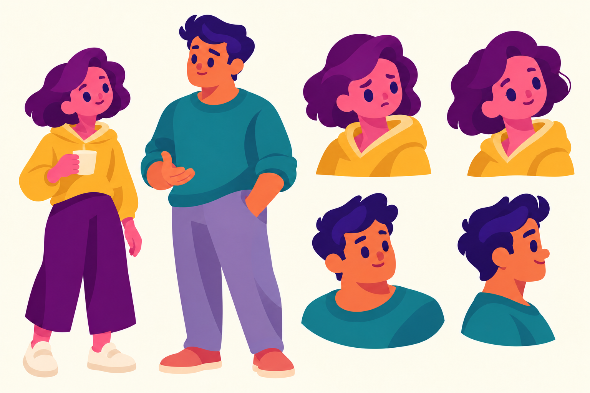

# Static character test 01

[Open or download the full-size PNG](https://github.com/jonaslacandola0617/odd-atom/raw/refs/heads/main/assets/characters/static-test-01.png)

This is a **1536 × 1024 static concept sheet** for judging the character drawings. It contains two full-body designs and four head-and-shoulder studies on a plain background, with no labels or decorative scene elements.

The changes to judge against the [previous character crops](crowd-rebuilt-review/faces.png) are:

- **Heads and hair:** fuller cheeks, compact noses, mouths placed inside the face, and flowing hair masses in place of the squared bob and repeated round quiff shapes.
- **Distinct silhouettes and costumes:** a shorter Mira with a mustard hoodie and wide cropped trousers; a broader Sol with a teal rolled-sleeve sweater and roomy trousers. Their outfits no longer repeat long collared coats.
- **Connected poses and hands:** natural shoulder slopes, body weight shifts, a cup grip close to the body, a relaxed conversational palm, and a side view with the head and shoulders turned together.
- **Expressions:** worried and interested Mira, attentive Sol, and a smiling profile. The final profile was corrected in a second image-generation pass to show one visible eye.

The sheet was produced with **image generation**, guided by the saved official Loneliness and The Last Human artwork. It is original concept artwork for this project. The source reference images remain identified as Kurzgesagt's artwork in the [generation record](character-static-test/generation.json). The [prompts](character-static-test/prompts.json) are retained for review.

This test uses softer shading than the flat Loneliness examples. It is a raster concept sheet; editable vector layers, a Remotion rig, and animated consistency have not been established. The earlier film remains available as comparison material.
