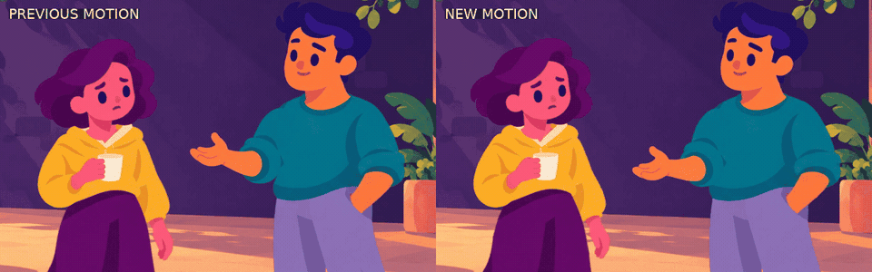

# Approved artwork — new 20-second motion pass

[Download the finished MP4](https://github.com/jonaslacandola0617/odd-atom/raw/refs/heads/main/assets/videos/approved-characters-motion-20s.mp4) · [Poster](../../assets/videos/approved-characters-motion-20s-poster.png) · [Previous approved-art film](../../assets/videos/approved-characters-20s.mp4)

The user's approved artwork is the locked baseline. The static character sheet, two transparent atlases, two background paintings, and previous MP4 retain their [recorded hashes](characters-motion/validation.json). This pass generates no replacement drawings. The original illustrations are the textures for the new rig.

## What changed

- **Connected acting:** anchored lower legs, restrained torso weight changes, and head-led attention. Sol looks, leans, anticipates, then opens his hand. Mira registers the invitation, inclines toward him, and responds after a short delay.
- **Elbow and wrist control:** continuous texture skinning replaces whole-arm-only rotation. Upper/lower arm and hand movements overlap in time. Authored anticipation, stroke, overshoot, hold, and settle keys replace continuous sine-wave character bobbing.
- **Cup response:** the hand/grip and cup move together. Steam is emitted at the moving cup and rises independently after emission.
- **Narration:** a fresh ElevenLabs generation using George / `eleven_multilingual_v2`, with the settings stored in [the new manifest](../../src/data/crowd-motion-narration.json). Spoken phonemes retain native speed (`speedAdjustment: 1`). A total of 1.3 seconds of silence was inserted into sentence gaps; the last caption ends at 18.137 s, leaving a readable closing hold.
- **Sound:** the original synthesized score and ambience were regenerated at quieter levels. One restrained cloth cue supports the arm gesture. There is no fabricated foot, chair, or cup contact.
- **Environment:** the approved painted plates remain held. Camera staging, foreground passers and independent steam provide movement. The reference study supports selective movement; this scene does not require every background detail to move.

The three-shot story and layered opening title remain. No branding, production notes, or extra headings appear in the movie.

## Encoded comparisons



The silent diagnostic loop compares the previous export starting at 8.0 s with the new export starting at 7.5 s. Each shows about 4.1 seconds of invitation/reaction at normal elapsed time, sampled at 12 fps and reduced to 960 × 300 overall. Labels appear only in this diagnostic. The delivered movie is 1920 × 1080 at 30 fps.

[Full sequence](characters-motion/sequence.jpg) · [Gesture breakdown](characters-motion/gesture.jpg) · [Blink and cup response](characters-motion/response.jpg) · [Artwork comparison](characters-motion/artwork-comparison.jpg)

These boards use decoded MP4 pixels. The artwork comparison includes the unchanged approved static sheet alongside the new actor poses. Face/hair construction, collar/neck connections, cuff/hand joins and cup grip were inspected at selected poses. The expression change occurs during the blink at frames 316–320. The environment color/value grouping and character designs are preserved.

## Verification

- TypeScript check passed; all 600 frames rendered and the complete MP4 decoded without errors.
- H.264 picture, AAC 48 kHz stereo; exact 20.000-second video/audio/container timing and fast-start metadata.
- 501,600 triangle configurations checked across 600 frames: no foldovers. Sampled lower-foot anchors have zero local displacement. The cup's sampled edge lengths remain rigid to floating-point precision.
- All six baseline file hashes match. This checks asset preservation; it does not assign a visual quality score.
- Final mix: -16.67 LUFS integrated, -4.30 dBTP, 5.70 LU loudness range.
- New speech and the previous speech are separate files; the delivered decoded audio differs from the previous export.

[Media/asset validation](characters-motion/validation.json) · [Geometry validation](characters-motion/geometry.json)

The rig remains a limited 2D illustrated rig. It does not provide a walk cycle, full turnaround or phoneme lip sync. The narrator describes the scene in third person, so conversational reactions carry the acting. Geometry, frame and audio measurements do not establish subjective performance quality or reference-studio parity.

## Reproduce

The committed assets and generated speech support offline rendering:

```sh
npm run typecheck
npm run render:characters-motion
npm run review:characters-motion
```

Select `MotionCharactersTest` in Remotion Studio. Motion source: [src/MotionCharacters.tsx](../../src/MotionCharacters.tsx). The old composition and media remain available for comparison.

Only when deliberately regenerating narration with ElevenLabs credits:

```sh
npm run narrate:characters-motion
npm run sound:characters-motion
npm run render:characters-motion
npm run review:characters-motion
```

API credentials remain in the secure `ELEVENLABS_API_KEY` environment binding. Generated audio, performance settings, pauses and alignments are versioned separately from the old voice profile.
