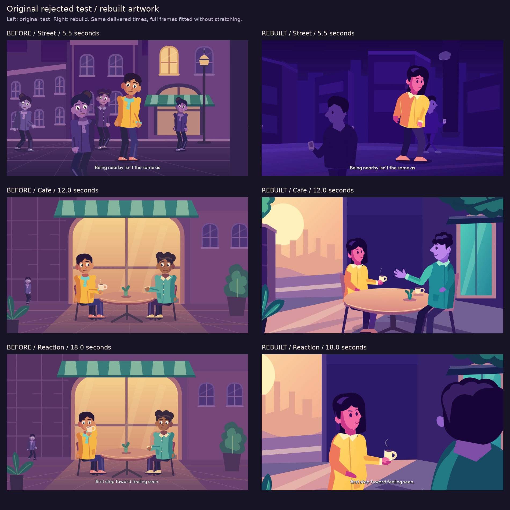
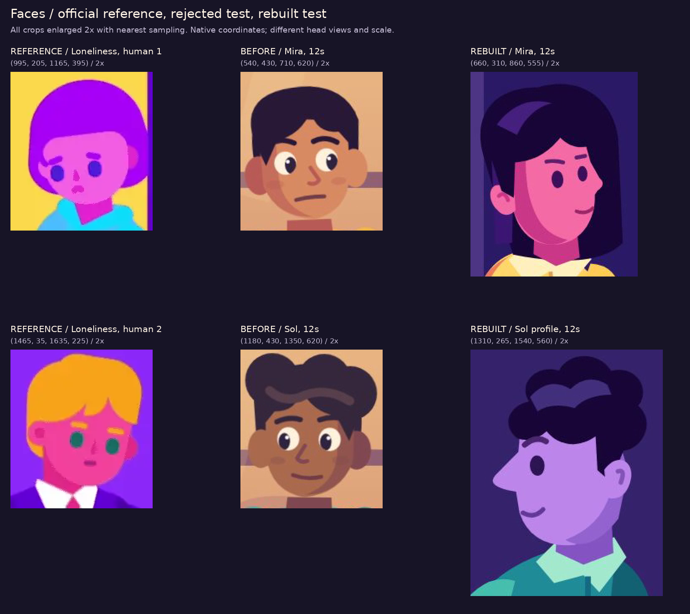
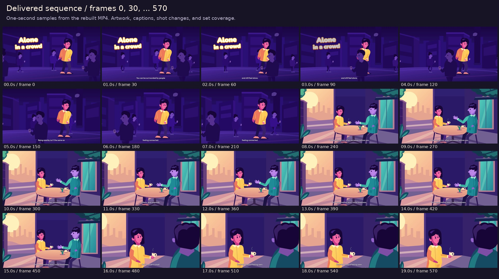
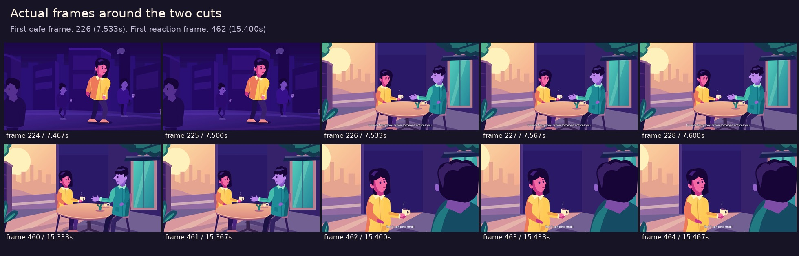

# Alone in a crowd — artwork rebuild

[Download the rebuilt 20-second MP4](https://github.com/jonaslacandola0617/odd-atom/raw/refs/heads/main/assets/videos/alone-in-a-crowd-rebuilt-20s.mp4) · [Poster](../../assets/videos/alone-in-a-crowd-rebuilt-20s-poster.png) · [Export checks](crowd-rebuilt-review/validation.json)

This version redraws the characters and environments in response to the [artwork audit](artwork-audit/README.md). It keeps the original story, existing generated ElevenLabs narration, aligned captions, and original sound stems. It is a new 600-frame Remotion animation, with three shots, moving crowd figures, illustrated character poses, gestures, head/expression changes, blinks, and animated steam and foliage. It is not a sequence of still reference images.

## Actual before/after artwork



| Rejected artwork problem | Applied drawing change |
|---|---|
| Large white eyes, pupils and glints dominated the faces | Solid dark eyes, fewer facial marks, and stronger hair/face color shapes |
| Both leads used the same face and body geometry | Mira has an offset bob and a right-facing three-quarter face; Sol has a separately drawn left profile, longer nose, cropped quiff, and a different jaw and torso |
| Tilting and mirroring a frontal head stood in for other views | Distinct three-quarter, profile, and rear drawings; the last shot uses a separately drawn foreground back view |
| Arm strokes created shoulder bumps and uniform tube limbs | Filled sleeve and trouser contours with tapered widths, specific bends, and overlapping shoulder shapes; no old Citizen rig is used |
| One fist was reused for several actions | Separate hanging fingers, an open conversational palm, and a cup-supporting grip with a visible thumb overlapping the cup |
| Neck shapes read as disconnected blocks | Shortened neck contours integrated with the collar openings; neck length was corrected after inspecting the first new stills |
| Bright repeated windows competed with the people | A broad, dark street palette and a terrace with a quiet cool wall behind the faces; the warm city view and glass door sit to the sides |
| Centered, equal-weight café arrangement | A smaller middle-distance Mira and a larger foreground Sol, followed by a closer reaction shot over Sol's shoulder |
| Repetitive architectural/floor linework | Broad building planes, a terrace edge, foliage framing, a few perspective shapes, and deliberate light/shadow masses; the floor grid is removed |

## Human-reference crop comparison



The left column is **official Kurzgesagt artwork** from the saved [Loneliness case study](https://kurzgesagt.org/projects/loneliness). The middle and right columns are our original rendered characters. The crops show native pixels enlarged twice, with coordinates; they are not aligned character models or a numerical style-match score. Differences in head direction and size remain visible.

The saturated street colors were checked on actual delivered frames, with the caption area excluded. The measurements are saved in the validation JSON. Color statistics describe the images; they do not establish that the artwork meets studio quality. The drawings remain an original interpretation rather than a traced copy of a reference frame.

## Story and acting

| Delivered frames | Shot and action |
|---|---|
| 0–225 | A brightly separated lead stands among darker phone-focused pedestrians at different depths. The title has multiple actual outline passes and disappears before the closer street framing. The lead's upper body leans forward with a downcast head. |
| 226–461 | The terrace establishes two people paying attention. Mira lifts her head; Sol makes two open-palm gestures; Mira responds with a small cup movement and expression change. |
| 462–599 | An over-the-shoulder reaction shot places Mira's face and cup against a quiet cool background. Her expression softens as the narration finishes. |

Only the story title and narration captions appear on screen. There are no production labels, badges, diagrams, timers, or branding overlays.

## Inspection and remaining limits

The first new stills were inspected before the full export. That review led to shorter necks, a smaller nose contour on Mira, tighter terrace framing, and an opening frame with open eyes. The first full sequence revealed the camera reaching beyond the street artwork; its pan is now limited to stay inside the set. Dialogue gestures and the cup response were made more visible, then the film was rendered again.





The retained review boards come from the **final encoded MP4**, as does the poster. One-second sequence samples, individual frames around both cuts, close face crops, and the last frame were inspected. Full decoding and stream checks are recorded separately. The narration is the previous genuine ElevenLabs generation; no new speech API request or account charge was needed. The review script compares decoded audio hashes with the earlier film.

The new drawing addresses the specific face, shoulder, hand, color, and staging problems. It does not establish pixel-identical reference quality. The supporting crowd still uses a small set of silhouettes, the environment remains comparatively simple, and the facial acting has a limited pose range. Those are concrete areas for further artwork development, rather than reasons to count the successful render as visual approval.

## Editable original assets and reproduction

- [Character and environment drawing source](../../src/art/ConnectionArt.tsx)
- [Shot composition and animation](../../src/Connection.tsx)
- [Six standalone SVG assets](../../public/assets/artwork/connection-rebuilt): standing/seated Mira, profile/rear Sol, the street, and the terrace
- [Existing ElevenLabs narration manifest](../../src/data/crowd-narration.json)
- [Review extraction script](../../scripts/review_connection.py)

```sh
npm ci
npm run typecheck
npm run assets:crowd-rebuilt
npm run render:crowd-rebuilt
python scripts/review_connection.py
```

Select `CrowdRebuilt` in Remotion Studio. Rendering requires Node.js 24.5+, Chromium, and FFmpeg; review extraction also needs Python 3, Pillow, and NumPy. The committed narration and sound stems are reused without an API request. The earlier film and artwork audit remain available for comparison.
