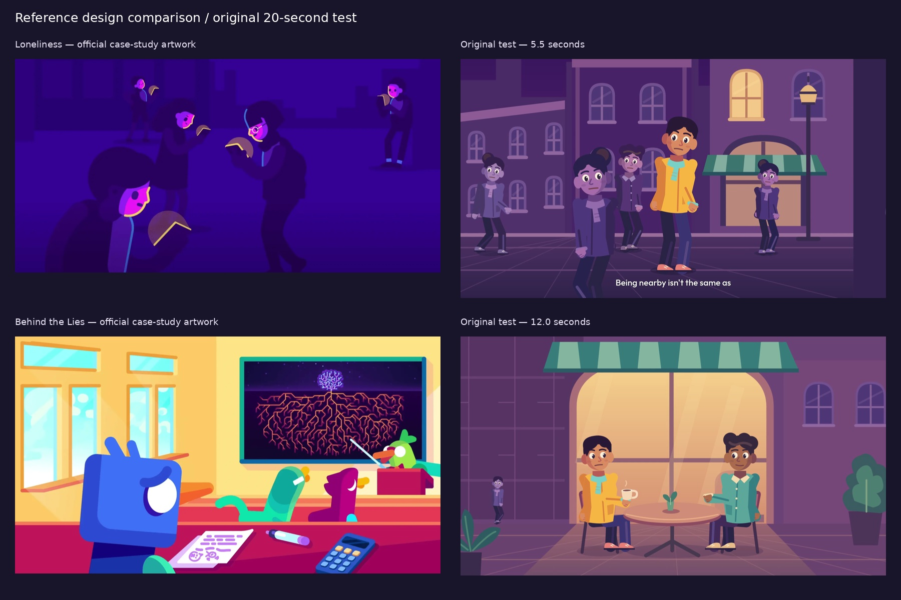
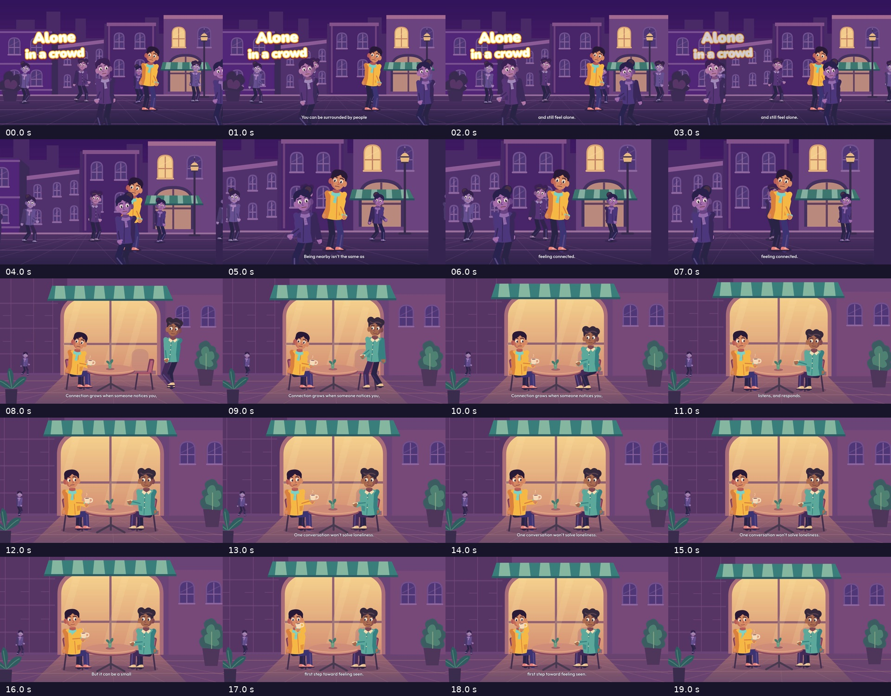
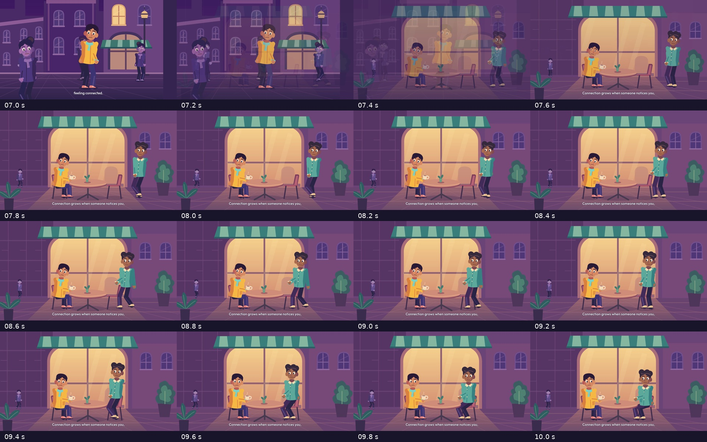

# Alone in a crowd — 20-second test and study comparison

[Download the MP4](https://github.com/jonaslacandola0617/odd-atom/raw/refs/heads/main/assets/videos/alone-in-a-crowd-20s.mp4) · [Poster](../../assets/videos/alone-in-a-crowd-20s-poster.png) · [Technical verification](crowd-review/validation.json)

This is an original 1920 × 1080, 30 fps Remotion animation with two original human leads, authored city/café artwork, generated ElevenLabs narration, aligned captions, original synthesized music, and quiet ambience. The MP4, audio stems, editable geometry, and neutral character/set SVGs are saved in the repository.

## Story

The script distinguishes being physically near people from feeling connected. It moves from a crowded street to two people paying attention to each other. Its ending presents conversation as a possible small first step, with an explicit limit on what one conversation can accomplish.

> You can be surrounded by people and still feel alone. Being nearby isn't the same as feeling connected. Connection grows when someone notices you, listens, and responds. One conversation won't solve loneliness. But it can be a small first step toward feeling seen.

The subject and human staging were informed by the [expanded reference study](../../references/studies/topic-range-2026-10-23/README.md), especially its official Loneliness case study. The script is original; it does not reproduce that episode's narration. Requests to retrieve the CDC social-connectedness page and HHS advisory were blocked, so those documents were not reviewed for this test. This segment uses a narrow qualitative premise rather than health statistics or diagnostic claims.

## The actual sequence

| Approximate delivered time | Action and explanatory purpose |
|---|---|
| 0–4.0 s | Layered opening title, original street, people moving at different depths, and the lead held apart through color and pose |
| 4.0–7.5 s | The view moves closer while passersby continue: proximity alone does not create interaction |
| 7.5–10.1 s | A brief dissolve establishes the café; the second lead approaches, slows, and sits |
| 10.1–12.6 s | Attention shifts toward the other person, with a small responding gesture |
| 12.6–15.4 s | The first lead responds; the narration qualifies the scope of the conversation |
| 15.4–20.0 s | A modest expression change, a cup lift, and a small pullback resolve the scene; the final voice/caption finishes around 18.7 s |

The four main story beats come from ElevenLabs character alignment, not an estimate of reading speed. `Crowd.tsx` maps those returned timestamps to the authored action sequence. Captions have their own aligned timing and stay at a fixed screen position while the camera moves.

## Side-by-side with the study



The left column contains downloaded **official Kurzgesagt reference artwork**. The right column contains frames from **our original animation**. The scenes have different content; the comparison concerns drawing, staging, hierarchy, and color. It is not a pixel-matching measurement.

| Area | Evidence in the study | What this test does | Remaining gap and next improvement |
|---|---|---|---|
| Human situations | The Loneliness images use everyday clothing, distinct situations, and human poses | Uses a street and a café, with attention and an ordinary shared setting carrying the idea | Lead characters still share much of one anatomy and face construction. Design separate body silhouettes and three-quarter head poses before the next rig pass |
| Color hierarchy | The isolated figures sit within a narrow purple world; warm/cool separation directs attention in the classroom | Keeps the crowd in an opaque purple family, separates the lead with saffron/mint, and gives the café a warm backdrop | Our midtones are more muted and less decisively separated. Strengthen intentional chroma/value differences and subordinate the large bright café window so facial acting attracts the eye |
| Composition | Reference images use strong foreground cropping, varied object scales, and asymmetry | Uses three crowd depths, foreground passers, a closer view, and a table between the leads | The café remains a centered two-shot. An over-shoulder reaction view or an asymmetrical close-up would better emphasize the change in attention |
| Shape and detail | Large silhouettes organize smaller shapes; detail is concentrated on meaningful objects | Authors coats, hair, faces, hands, chairs, a mug, a table, plants, and layered façades | Repeated windows and floor lines feel regular. Replace some repetition with a few scene-specific, deliberately placed forms |
| Character acting | Still references demonstrate a broader range of posture and expression | Has connected limb segments, a continuous sit, head/gaze changes, clipped blinks, gestures, and a hand-driven cup lift | More distinct anticipation, shoulder/torso turns, hand poses, and reactions would reduce the remaining puppet quality |
| Text | The selected case images show functional labels where needed, but do not establish opening-title or caption treatment | Uses the project's requested layered title and short outlined white captions, without badges or production text | Title/caption similarity cannot be scored against this set of reference stills; a verified episode typography study is still needed |
| Motion and sound | Full reference playback remains blocked | Own sequence was inspected with one-second frames, dense arrival samples, and closing-action frames; generated narration is in the export | No verified reference timing or soundtrack comparison is possible yet. Audio levels were measured; no subjective listening review is claimed |

### Three highest-value improvements for the next pass

1. **Build a more expressive, varied human cast.** Separate the leads' proportions and head shapes, add three-quarter turns, and design a small set of strong acting poses before interpolating them.
2. **Re-stage the café around the relationship.** Use an asymmetrical viewpoint and a motivated reaction close-up, with the background's brightest shapes supporting the faces.
3. **Strengthen color hierarchy and concentrate detail.** Give the focal accents and supporting color masses more deliberate separation. Reduce the large bright window and repeated architectural lines that compete with the action; make a few meaningful props more distinctive.

These are production judgments grounded in the saved frames. The result is a test of a broader human setting and an end-to-end narration workflow; equivalent studio quality or audience performance has not been established.

## Fixes applied during this test

The first still review exposed translucent crowd figures and overly flared resting elbows. Crowd figures now render opaquely, limb targets and bend direction were revised, and the leads gained different collar/scarf treatments. A malformed mouth curve was corrected so expression changes render properly.

The sequence review exposed a walking cycle continuing into the stop and a pullback that revealed the edge of the set. Walk/sit timing now separates the approach from the settling action; camera scale stays within the drawn scene. The closing cup action was reviewed for face/prop layer order. Caption grouping was tightened to avoid a flashing single-word fragment and artificial one-frame gaps between adjacent phrases.

## Sequence evidence





The sequence sheet samples frames 0, 30, …, 570. The arrival sheet samples frames 210–300 every six frames, covering 7.0–10.0 s. These are sampled visual inspections, not a claim to have watched inaccessible reference episodes or listened to their soundtracks.

## Narration and audio

ElevenLabs generated the voice successfully through `@elevenlabs/elevenlabs-js`, using the documented George voice ID and `eleven_multilingual_v2`. The actual API response supplied the audio and character alignment. A pitch-preserving 0.9 tempo adjustment lengthened the initial read; captions and scene beats were retimed accordingly. No second generation was needed to adjust its pace.

The score and ambience are original deterministic oscillator/noise synthesis. The final export mixes the three PCM stems and encodes AAC once, while preserving the rendered H.264 picture. This gives exact 20-second audio/video track timing and fast-start metadata. The measured final levels and source/output hashes are recorded in [validation.json](crowd-review/validation.json).

No secret is stored in the source, exported SVGs, or media metadata. The environment binding is used only by the build-time narration client. Existing generated assets support offline re-rendering.

## Reproduce

```sh
npm ci
npm run typecheck
npm run assets:crowd
npm run sound:crowd
npm run render:crowd
```

The committed narration and manifest are sufficient for a re-render. To change the narration, edit `src/data/crowd-narration.json` and run `npm run narrate:crowd` with the secure environment key; that creates a new ElevenLabs generation and uses account credits. Regenerate the sound after changing timing cues, then render again.

Main editable sources are `src/Crowd.tsx`, `src/characters/Citizen.tsx`, and `src/art/City.tsx`. Standalone SVGs are in `public/assets/characters/` and `public/assets/sets/`. The earlier star test remains available separately and retains its own pending narration state.
