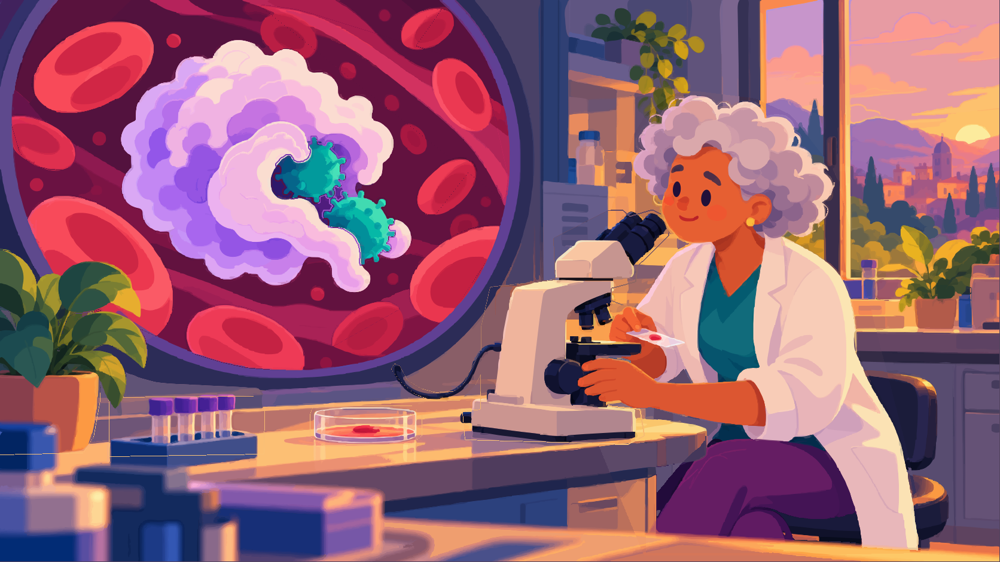

# Medicine scene: editable vector reconstruction

**[Download SVG package](https://github.com/jonaslacandola0617/odd-atom/raw/refs/heads/main/assets/scenes/medicine-vector/medicine-vector-editable.zip)** · [Standalone SVG](https://github.com/jonaslacandola0617/odd-atom/raw/refs/heads/main/assets/scenes/medicine-vector/medicine-scene-editable.svg) · [PNG preview](../../assets/scenes/medicine-vector/medicine-scene-preview.png) · [Remotion render](../../assets/scenes/medicine-vector/medicine-scene-remotion.png)

This is an **image-derived vector reconstruction** of the approved medicine scene. It contains native cubic Bézier paths, eye ellipses, gradients and vector clips. No bitmap is embedded or linked. It is not a manually drawn-from-scratch illustration, and equal artwork quality has not been inferred from successful conversion.



## What is editable

The SVG has **30 named layers** and **8,752 paths**, including the clinician and head/neckline, eyes, scrubs, coat/cuffs, trousers, both hands, microscope/cable, individual red cells, immune cell, two microbes, foliage/pot, specimen tubes/tray, culture dish and specimen slide. It uses two native eye ellipses, with editable skin fills beneath them for expression changes.

The file is approximately **10.8 MB**. Its shading is expressed largely as traced color regions. The Layers/Objects panel and Node tool in Inkscape expose the groups and curve geometry. Colors can be changed with Fill & Stroke; gradients and silhouette clips are also native editable SVG objects. Some geometry remains bounded by vector clips rather than reduced to a minimal artist-authored path construction.

## Comparison and editing checks

[Approved PNG versus actual SVG render](medicine-vector/comparison.jpg) · [Editing demonstration](medicine-vector/editing-demo.png) · [Clinician layer hidden](medicine-vector/clinician-hidden.png)

The edit demonstration changes SVG XML directly: it closes the eyes with native strokes and moves/recolors the upper microbe. The subject-removal proof hides the clinician group. These renders establish that the subjects/features can be selected and changed as vector geometry. They also expose the reconstruction's limits: painted shadows and occluded details can remain in adjacent groups, and hidden surfaces are approximate. Moving parts can require further vector cleanup. A finished animation rig, alternative poses and fully reconstructed hidden anatomy have not been authored.

The illustration retains its composition, palette and major shapes. Soft shading becomes more stepped, some contours simplify, and a few edges differ. The side-by-side board includes native-pixel face/hand crops so those differences can be judged directly. Pixel error statistics in the validation record are reconstruction measurements, not aesthetic quality scores.

## How it was built

1. The approved original PNG supplies the drawing reference; the existing animation clean plate supplies obscured room context.
2. VTracer fits a common Bézier/color solution. Contours are prepared at twice the input resolution to reduce small edge artifacts.
3. Source/object silhouettes and color regions establish named groups. Independent curve copies are bounded to each object with native vector clipping; no full-frame image element is used.
4. Native gradients complete limited hidden wall/bench/cell-well regions. The eyes are rebuilt as smooth SVG ellipses.
5. Inkscape and the Remotion Chromium renderer independently render the standalone SVG. The original approved PNG remains unchanged.

No new image-generation request was made for this task. The supplied SVG is derived from the previously approved generated artwork and animation assets.

## Validation

[SVG structure and editing checks](medicine-vector/validation.json) · [Build/layer record](medicine-vector/build.json) · [Delivered-file hashes](medicine-vector/delivery.json)

Verified: zero raster image elements or linked bitmaps; zero scripts/foreign objects; unique IDs; internal references resolve; Inkscape renders the file; Remotion renders the SVG at 1920 × 1080 with no PNG fallback. TypeScript checking passed. The runtime SVG is byte-identical to the standalone delivery.

## Use in the project

Open the SVG directly in Inkscape, or select `MedicineVectorArtwork` in Remotion Studio. The composition renders the native SVG as a static artwork; previous animation MP4s remain unchanged and continue to use their documented raster rigs.

```sh
npm run render:medicine-vector
```

The optional reconstruction pipeline uses Python dependencies pinned in `requirements-vector.txt`, plus Inkscape:

```sh
python -m pip install --target .cache/vector-tools -r requirements-vector.txt
npm run build:medicine-vector
npm run review:medicine-vector
```

The source is [build_medicine_vector.py](../../scripts/build_medicine_vector.py), the review utility is [review_medicine_vector.py](../../scripts/review_medicine_vector.py), and the Remotion composition is [MedicineVector.tsx](../../src/MedicineVector.tsx). After rebuilding, copy the standalone SVG to `public/assets/artwork/medicine-vector/medicine-scene-editable.svg` before rendering in Remotion.
