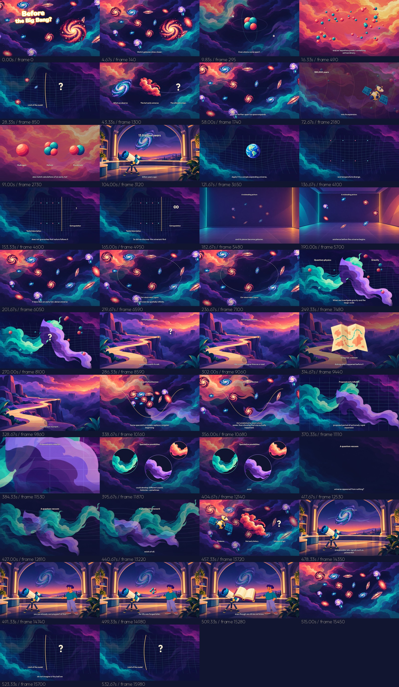

# What Was There Before the Big Bang? — first full-length cut

**[Download complete 1080p MP4](https://github.com/jonaslacandola0617/odd-atom/raw/refs/heads/main/assets/videos/singularity/singularity-full-8m56.mp4)** · [Higher-bitrate five-part version](https://github.com/jonaslacandola0617/odd-atom/tree/main/assets/videos/singularity/chapters) · [Poster](../../../../assets/videos/singularity/singularity-poster.png) · [Subtitles](../../../../assets/videos/singularity/singularity-captions.srt)

The first full-length illustrated cut uses the user's Google Vids **Knox** recording. Picture runs **16,099 frames at 30 fps, 1920 × 1080**, approximately **8:56.63**, including the tiny final-frame rounding after the 8:56.619 recording. The voice is not regenerated or stretched to fit a previous estimate. It is mixed in stereo with a quiet original synthesized score and timed effects.



## Artwork and movement

The artwork package contains **six generated environment plates**, **five source sprite atlases**, and **28 separate transparent PNG objects/field layers**, guided by the approved project medicine/cyber artwork. The film instantiates the objects needed for its scenes; additional prepared sprites remain available in the package. These are original project illustrations, not downloaded reference-channel frames. [Generation prompts and provenance](artwork-generation.json) · [Download layered PNG artwork](https://github.com/jonaslacandola0617/odd-atom/raw/refs/heads/main/assets/scenes/singularity-layered-artwork.zip)

The approved Sol drawing and continuous shoulder/elbow/wrist/torso rig are reused for the observatory human scenes. The original approved character master, medicine and cyber illustrations remain unchanged. New full-film artwork and animation quality are pending the user's review; previous approval of a different test is not approval of this delivery.

[Native-pixel human artwork comparison](human-native-comparison.png) checks the approved human reference against the encoded film's face and hand. Sizes and poses differ; this is not a registered pixel overlay. The same solid oval-eye treatment, indigo hair, orange skin, teal sweater, lavender trousers and original gesture artwork are retained. Early composition review found busy backgrounds competing with the physics explanations and sharp sprite-cell edges; the final assets use quieter backplates in those sections and narrow alpha-edge fades on the exported objects. These are concrete composition fixes, not an assertion of user quality approval.

- Galaxies move, change spacing and rotate separately from the environment; stars and the foreground galaxy field occupy distinct depth layers.
- Stellar components reverse into nebular gas. Atomic parts separate, and independent particles compress in the hot-history illustration.
- The ancient-light sequence transitions from opaque warm plasma toward a clear field, with separate radiation paths and satellite artwork.
- Spacetime geometry and coordinate markers animate through a classical extrapolation. A boundary and missing continuation distinguish the model limit from an observed physical object.
- The wrong “dot inside a room” mental image is explicitly labeled as misleading, then replaced with large-scale expansion without a marked central launch site.
- The observable region is drawn within a continuing galaxy field. Its boundary is not presented as the physical edge of all existence.
- Time is illustrated through a metaphorical landscape and map. Quantum/gravity fields move independently; the absence of an established combined account remains visible.
- The bounce and multiverse pictures carry hypothesis labels. Inflation is shown with abstract scale/field imagery, not galaxies or stars existing during that early phase.
- The observatory has independently moving sky objects/field layers over its fixed architecture, and the character makes staged gestures using the passed rig. Some set surfaces and props are intentionally held rather than made to float continuously.

Only explanatory labels, a multi-stroke opening title and compact narration captions are used. No episode badges, branding blocks, timers, production metadata, unrequested calls to subscribe or filler end card appear.

## Sound and timing

The original uploaded narration and extracted original M4A remain immutable. The final mix resamples to 48 kHz stereo, applies a small mix gain and peak limiting, and preserves speech speed, pitch and timing. No ElevenLabs or other speech-generation request was made. The score/effects are synthesized from deterministic oscillators, envelopes and filtered noise; no commercial soundtrack is sampled. [Sound-design cues and settings](sound-design.json)

The 52 visual cues use the actual [speech timing manifest](../../../../src/data/singularity-narration.json). Captions come from the supplied script and acoustic alignment. Their wording is preserved, including two previously documented recognizer ambiguities; a complete manual subtitle/listening audit is not claimed.

The complete MP4 is sized below GitHub's single-file limit. The five-part version preserves the higher-bitrate CRF19 picture renders, with each part individually voiced and downloadable. The renderer retains the continuous master in ignored `out/singularity/` for local assembly; the canonical full soundtrack avoids accumulating audio edits at chapter joins.

## Source and reproduction

[Film source](../../../../src/Singularity.tsx) · [PNG export](../../../../src/SingularitySpriteExport.tsx) · [Render/assembly script](../../../../scripts/render_singularity.cjs) · [Original sound generator](../../../../scripts/singularity_sound.py) · [Delivery validation](validation.json)

```sh
npm run typecheck
npm run sprites:singularity   # optional; exported PNG objects are committed
npm run sound:singularity     # optional; the final mix is committed
npm run still:singularity
npm run render:singularity
npm run review:singularity
```

Select `SingularityFullFilm` in Remotion Studio. Offline playback/rendering uses committed assets and needs no image-generation or voice-generation API. The environment's browser is `/usr/bin/chromium`. Python production/review helpers use NumPy, SciPy, Pillow and FFmpeg. Resumed picture renders require both matching frame counts and a fingerprint of the actual illustration/code/font/timing inputs. A changed soundtrack alone can be remixed without re-rendering unchanged picture; changed artwork or captions cannot silently reuse stale chapters.

Validation covers real encoded frame counts, dimensions, audio format, full decoding, no unexpected black segments, fast-start structure, voice correlation at multiple points, artwork/source hashes, and chapter durations. The user's visual and listening review determines the next artwork/motion revisions.
