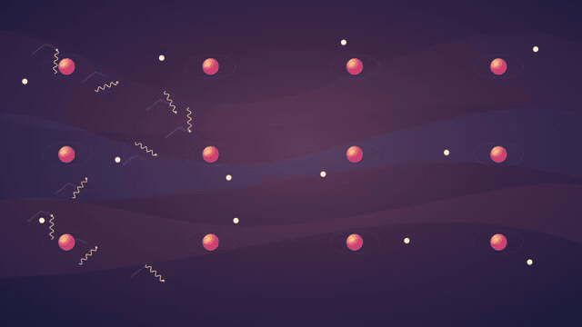

# Singularity — full animation remake

[**Download the complete 8:56 MP4**](https://github.com/jonaslacandola0617/odd-atom/raw/refs/heads/main/assets/videos/singularity-v2/singularity-rebuilt-8m56.mp4) · [Opening 30 seconds](../../../../assets/videos/singularity-v2/opening-30s.mp4) · [Poster](../../../../assets/videos/singularity-v2/singularity-rebuilt-poster.png) · [Optional subtitles](../../../../assets/videos/singularity-v2/singularity-subtitles.srt)

The user approved the [20-second story/object-motion test](../../story-motion/user-review.json) and requested rebuilding the entire singularity film. This is a separate Remotion production: **16,099 frames, 1920 × 1080, 30 fps**, spanning the original **8:56.619 Google Vids Knox recording**. The video has no opening title, on-screen headings, labels, branding, dashboard badges or end card. Subtitles are supplied separately and are disabled in the delivered picture.

The earlier full cut remains [rejected and unchanged](../film/user-review.json). The passed character, medicine and cyber artwork, both approved motion tests and original narration also remain unchanged. This new full-film version is **not passed** following the user's review; approval of the short test is not approval of this film. See [the user feedback](user-review.json). The user requested stronger SFX and a less abrupt, curiosity-led ending; broader animation study will follow with user-supplied long-form references.

## What changed

The movie is built from **27 sequences and 52 speech-timed beats**. Objects bind, separate, react, approach boundaries, carry signals and change the next state. The [action storyboard](storyboard.md) records each action and consequence; the [sequence plan](sequence-plan.json) records coverage and transition timing.

- **Recombination:** electron motion settles around nuclei before formerly scattered light travels freely. Wavelengths stretch and a receiving dish responds.
- **Elements and matter:** nucleons approach and settle into light-nucleus examples. Later carbon-12 and oxygen-16 diagrams contain respectively six and eight protons, with matching neutron counts.
- **Gravity and model limits:** matter arrives before the grid bends. Separation contracts in the classical reversal. A marker advances along supported tiles while unsupported pieces fall away, then stops at the explanatory boundary.
- **Expansion:** the invented room has explicit walls; panels unfold away into a continuous expanding field. A local observation region contracts without replacing all existence with one measured dot.
- **Possible histories:** a time route encounters an initial boundary; a map pin reaches its defined domain. A finite hypothetical bounce must face a comparison trace. Inflation expands a field patch; speculative disconnected regions remain unlinked.
- **Vacuum and observation:** an apparently empty view reveals underlying fields and a local excitation. A framework appears around the process. Telescope aim, receiving geometry and comparison traces provide the measurement sequence.
- **Human connection:** the approved Sol texture and rig return. Primordial and later stellar matter motifs connect the narration to the human, followed by a compressed rewind and an unfinished model boundary.

The **26 major joins use moving geometry**, including expanding apertures, radiation-wave contours, unfolding walls/pages, spreading grid bands and a splitting model edge. The outgoing scene continues on the current frame through the join. There is no frozen outgoing screenshot or repeated whole-scene opacity dissolve. The [handoff boards](handoffs-01.jpg) show samples from actual encoded frames, with the [remaining handoffs here](handoffs-02.jpg).

## Artwork and sound

This remake has no full-frame generated universe backplates. It combines independently animated existing alpha sprites, newly authored SVG settings and geometry, layered skies/terrain, field motion and the approved human illustration. The source sprites are reused as individual actors, with recurring motifs where the explanation explicitly returns to them. New landscapes, architecture, telescope/dish parts and diagram geometry remain editable in [the Remotion source](../../../../src/SingularityRebuild.tsx).

New action-timed effects accompany the existing original synthesized score. The **original Knox source stays immutable**, at its original pace and pitch. The mix applies level control and a peak ceiling; it uses no voice service or speech credits. [Sound design](sound-design.json) records the source hash, mix settings and 40 effect cues.

The diagrams are stylized explanatory pictures, not scale-accurate physical simulations. The room is the explicitly introduced misconception; road/map imagery is an analogy; bounce, inflation mechanisms and multiverse histories remain proposals. No stars/galaxies are placed in the inflation or primordial-plasma scenes, and the possible relic-wave motif is not presented as a detection. Scientific distinctions still depend partly on the original spoken qualifications; silent playback alone cannot establish every claim.

## Review and downloads



This GIF is an **18-second silent review montage** of six three-second excerpts, with an artificial loop restart. It is not the edit or pacing of the full movie.

[Beat frames 1–26](sequence-review-01.jpg) · [Beat frames 27–52](sequence-review-02.jpg) · [Before/after comparison](before-after.jpg) · [Native-pixel character comparison](character-native.png) · [Technical report](delivery.json)

The report checks actual encoded duration/frame count, full decoding, unexpected black segments, fast-start structure, chapter lengths, original-file hashes and voice alignment at five separated points. The boards sample all narration beats and all major joins. These checks and representative visual inspection do not assert a complete human listening audit, studio equivalence, audience comprehension or guaranteed view counts.

The complete 1080p download is packaged below GitHub's single-file limit. For the higher bitrate picture, use the five voiced chapter downloads in order:

1. [Part 1](../../../../assets/videos/singularity-v2/chapters/singularity-rebuilt-part-1.mp4)
2. [Part 2](../../../../assets/videos/singularity-v2/chapters/singularity-rebuilt-part-2.mp4)
3. [Part 3](../../../../assets/videos/singularity-v2/chapters/singularity-rebuilt-part-3.mp4)
4. [Part 4](../../../../assets/videos/singularity-v2/chapters/singularity-rebuilt-part-4.mp4)
5. [Part 5](../../../../assets/videos/singularity-v2/chapters/singularity-rebuilt-part-5.mp4)

```sh
npm run typecheck
npm run sound:singularity-v2     # optional: completed mix is committed
npm run still:singularity-v2
npm run render:singularity-v2
npm run review:singularity-v2
```

Select `SingularityRebuildFull` in Remotion Studio. The renderer saves temporary chapter masters under ignored `out/singularity-v2/` and final MP4s/poster/subtitles under tracked `assets/videos/singularity-v2/`. It does not overwrite the earlier cut or spend voice credits.
