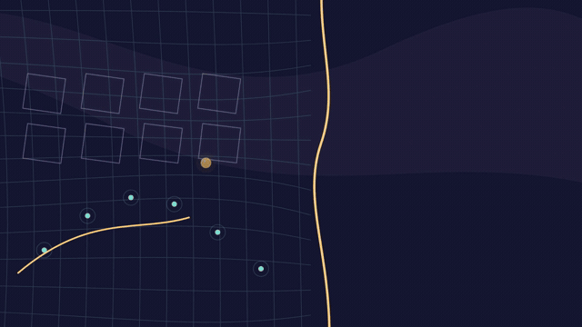

# Singularity — sound and ending correction

[**Download the revised full MP4**](https://github.com/jonaslacandola0617/odd-atom/raw/refs/heads/main/assets/videos/singularity-v3/singularity-sound-ending.mp4) · [Watch/download the ending](../../../../assets/videos/singularity-v3/ending-preview.mp4) · [Imported reusable SFX library](../../../../public/assets/audio/library/curio-bureau/README.md) · [Committed revised stems](../../../../public/assets/audio/singularity-v3/README.md)

The user said the [v2 full-film animation still did not pass](../rebuild/user-review.json), and requested more established SFX and a less abrupt ending that leaves curiosity. This version addresses **sound and the final visual sequence**. The broader animation study remains deferred until the user supplies long-form references. Neither a successful encode nor this correction establishes an animation or listening pass.

The user explicitly chose **keep Knox; improve visuals and sound**. The original Google Vids take remains unchanged, at its native pace and pitch, with no new spoken line or voice-service request. There is no on-screen title, heading, branding or end card. Optional subtitles remain separate.

## Sound

The user supplied [their Curio Bureau audio folder](https://github.com/jonaslacandola0617/curio-bureau/tree/main/audio). Its complete audio directory is now copied into this project: **57 usable cues plus the source audition reel**, with original catalogs retained. [IMPORT.json](../../../../public/assets/audio/library/curio-bureau/IMPORT.json) pins source commit `a021f771dc767146993a00aa4d01c178aa3993d2`, hashes and audio formats. Source QA/approval records describe the original library, not approval of this new film.

The new mix reuses **38 existing cues in 165 placements**, including environment-loop placements. No new generative sound request was made. Approach, contact and aftermath now have different roles:

- **Scale and density:** layered depth passes, progressively straining textures and restrained low impacts.
- **Particles and structures:** separate capture/contact events and settling details; unsupported model pieces have strain and multiple timed falling-piece accents.
- **Diagram material:** paper turns, pencil/route marks, slides and hinges accompany the room panels, time road, map and final page.
- **Instruments:** aim mechanisms, search textures, receiver pulses, sweeps and a quiet electronics bed support the observational actions.
- **Story reversals:** recurring restrained tension and reduced score energy distinguish unresolved claims from earned evidence matches.

The old separate SFX stem measured a median **29.8 dB below simultaneous voice** in its voiced cue windows; the revised effects bus measures approximately **12.6 dB below simultaneous voice** in its own voiced event windows. These are different event sets, so this is an audit of the mixes, not a controlled loudness match or an ideal level for every scene. Speech-presence automation reduces effects and ambience under words; the narration itself is not retimed. The final mix has peak limiting.

[Previous sound — same 30-second picture interval](previous-sound-30s.mp4) · [Revised sound — same interval](revised-sound-30s.mp4) · [All cue placements, levels and origins](sound-design.json)

**Audition limit:** this runtime cannot directly audition audio. The [reference study](../../../../references/studies/sound-2026-10-25/README.md) measures the eight supplied mixed tracks and aligns 12 intervals with visible actions; it does not isolate or identify particular reference SFX. The A/V excerpts and the two mix previews are provided for the user's listening review. Source cues are designed/synthesized sounds, not authentic field recordings. Cosmic/particle effects are fictional sonification.

## Ending

The original movie stopped only a fraction of a second after the final recorded question. The new sequence gives that question a consequence:

1. A history marker approaches the last drawn part of the model and stops there.
2. During “where our explanation runs out,” the view starts pulling back. The boundary is revealed as part of a drawn map.
3. After the voice finishes, a page lifts with paper motion/sound. An unfilled region appears, with only tentative, incomplete marks.
4. The map lingers, then picture and sound taper gradually.

The visual hook is **our drawing has reached its edge; what would fill the next part?** It leaves the origin unknown. The page/map is an analogy for knowledge, not a physical edge of space, evidence of another universe or a claim about what preceded the Big Bang. The original spoken question is retained exactly.

The video now runs **548.633 seconds (9:08.633)**: **16,459 frames at 1080p/30 fps**, adding a 12-second visual tail after the old picture endpoint. The revised ending starts at frame 15,620; earlier scene motion/artwork is retained. The first four higher bitrate chapter pictures are remuxed from v2 without video changes. The prefix of chapter five is re-encoded for an accurate join, and its ending is newly rendered in Remotion.



[Ending frames from the actual final movie](ending-sequence.jpg) · [Encoded-file and source checks](delivery.json) · [Remotion ending source](../../../../src/SingularitySoundEnding.tsx)

## Higher bitrate downloads and reproduction

1. [Part 1](../../../../assets/videos/singularity-v3/chapters/singularity-sound-ending-part-1.mp4)
2. [Part 2](../../../../assets/videos/singularity-v3/chapters/singularity-sound-ending-part-2.mp4)
3. [Part 3](../../../../assets/videos/singularity-v3/chapters/singularity-sound-ending-part-3.mp4)
4. [Part 4](../../../../assets/videos/singularity-v3/chapters/singularity-sound-ending-part-4.mp4)
5. [Part 5, extended ending](../../../../assets/videos/singularity-v3/chapters/singularity-sound-ending-part-5.mp4)

The complete file is packaged below GitHub's single-file limit. The earlier full movies, approved motion tests, artwork and Knox source remain intact. Newly mixed `effects`, `atmosphere`, `score` and `final-mix` audio are committed for future reuse alongside the imported originals.

```sh
npm run typecheck
npm run study:sound           # uses existing uploaded reference files
npm run sound:singularity-v3  # no service calls; existing source cues
npm run still:singularity-v3
npm run render:singularity-v3
npm run review:singularity-v3
```

Select `SingularitySoundEnding` in Remotion Studio. The renderer rebuilds only the ending and uses the committed v2 chapter picture for the unchanged sections. Technical verification covers source hashes, full decoding/frame counts, levels/taper, five voice-sync windows, chapter lengths and preservation of the first four chapter video bitstreams. Direct listening approval remains with the user.
