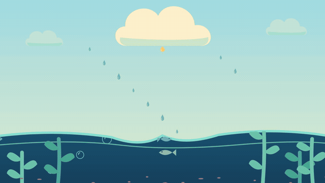
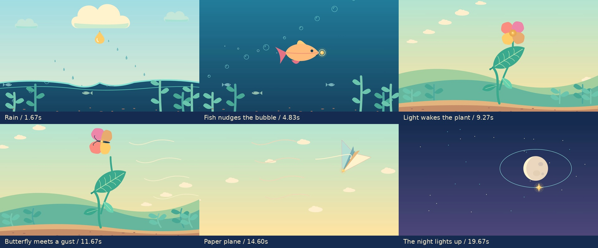
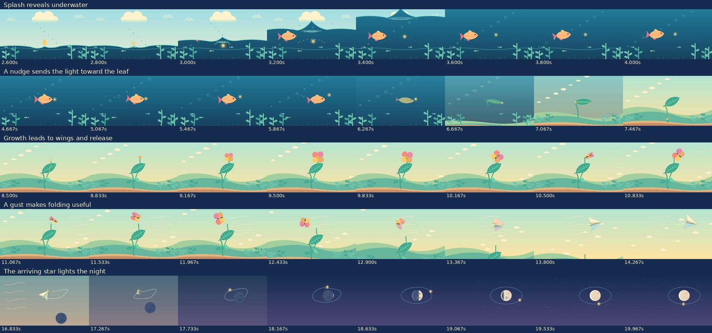

# Six-scene story and object-motion rebuild

**[Download the new 20-second MP4](https://github.com/jonaslacandola0617/odd-atom/raw/refs/heads/main/assets/videos/story-motion/storytelling-motion-20s.mp4)** · [Poster](../../../assets/videos/story-motion/storytelling-motion-poster.png) · [Earlier approved transition test](../transition-lab/README.md)

This is the user's requested recreation of the **20-second, six-scene test**, confirmed separately from the full singularity film. It keeps the approved vector drawings and five shape/action handoffs in a new Remotion composition, while giving the scenes a visible recurring subject and causal reactions. The first scene and the rest of the film have **no on-screen title, captions, labels or branding**. It is wordless, with original synthesized sound effects and no voice-credit use.



The GIF is a 640-pixel, 20 fps silent proxy with an artificial restart. The MP4 is 1920 × 1080 at 30 fps, with the complete effects track.

## What happens

A golden drop disturbs the pond. A fish notices and nudges the resulting bubble onward; its changing shape introduces a leaf. The light enters the plant, travels through it, and precedes the leaf/flower unfurling. Petals become a butterfly. A gust pushes against its flight while moving the surrounding foliage and clouds. Its wings fold into a plane, which gains ground and carries the light into the night. The resulting star circles a dark moon as the moon and nearby stars brighten.

This is a graphic fable using the transformations from the approved test. Fish-to-leaf, petal-to-butterfly and star-lit-moon actions are visual fantasy, not claims about biological development or astronomical illumination.

| Approximate interval | Readable action | Consequence that carries forward |
|---|---|---|
| 0–3.33 s | The cloud compresses/releases the larger drop; it accelerates toward the pond. | Contact starts spray, spreading ripples and a delayed response in underwater plants. |
| 3.33–6.67 s | The fish attends to the bubble, accelerates with tail strokes, makes contact and recoils. | The bubble compresses and moves onward, then merges into the emerging leaf. |
| 6.67–10 s | The light follows the leaf midrib and stalk, then travels upward toward the bud. | The folded leaf opens, side growth appears and the flower unfolds before the petals depart. |
| 10–13.33 s | Released petals flap as wings; a shared gust pushes the flyer back. | The same gust bends foliage and displaces cloudlets/wind marks; the wings begin folding. |
| 13.33–16.67 s | The paper form gains ground along the continuing trajectory, with small elastic tip responses. | Its trail persists and changes into an orbit while the carrier becomes a star. |
| 16.67–20 s | The star arrives beside a dark moon and continues around it. | A moving light boundary brightens the moon and a spatial wave introduces surrounding stars. |



## Object and environment behavior

The recurring golden carrier supplies a focal point through the sequence. It stays attached to the leaf/stalk trajectory during growth, then to the flower/flyer/plane during the later handoffs. Its size was increased during the still-frame review to make it easier to follow.

- **Fish and bubble:** eye direction, changing tail/fin poses, anticipation/acceleration, contact compression and recoil replace a simple position-only swim. Bubbles emitted by the fish rise in world space after emission.
- **Water and foliage:** ripples begin at impact. Kelp responds with distance-dependent delay, and its leaves attach to points on the bending stem. A later wake adds a second local reaction.
- **Plant:** a curled state precedes unfurling. The light moves along visible paths before the flower opens; the released flower stem has a damped recoil.
- **Wind and flight:** foliage, cloudlets, wind traces and the flyer respond to the same authored gust. Wing rhythm changes during the struggle, then the paper form continues the trajectory.
- **Depth and the night:** foreground plant, distant hills and cloud layers have different travel. The arriving star precedes the moon's growing illuminated region; surrounding stars appear according to distance from that region.

These actions use local deformation, attachment, event-triggered movement, lag and settling. The sequence retains the approved handoffs rather than adding a whole-scene dissolve between still illustrations.



## Review and source

[Comparison with the approved test](approved-comparison.jpg) · [Object-state/contact diagnostics](object-motion.json) · [Encoded-file review](delivery.json) · [Animation source](../../../src/StoryMotionLab.tsx)

The original approved transition MP4 and original animation source remain unchanged. The new render is a separate version with **600 frames / 20 seconds**, H.264 1080p/30 fps picture and AAC 48 kHz stereo sound. Review covers actual encoded frames, full decoding, the contact location and carrier continuity. Those checks do not establish that every viewer will infer the intended story; creative approval of this rebuild remains pending the user's review.

The previous full singularity film remains rejected and is not replaced by this test. The approved character/medicine/cyber artwork and the original Knox recording are untouched.

```sh
npm run typecheck
npm run sound:story-motion    # optional: committed soundtrack is available
npm run still:story-motion
npm run render:story-motion
npm run review:story-motion
```

Select `StoryMotionSixScenes` in Remotion Studio. The movie has no generated raster scene plates, external production imagery or synthesized narration. The animation source is an independently versioned extension of the approved test's authored SVG paths.
