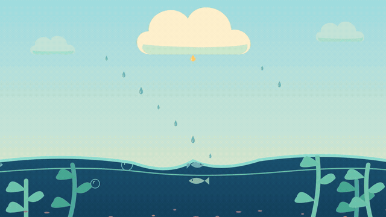
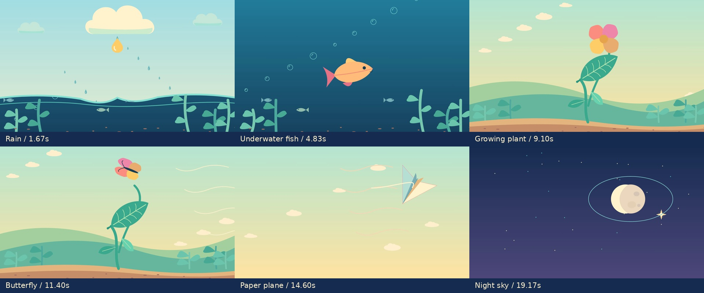
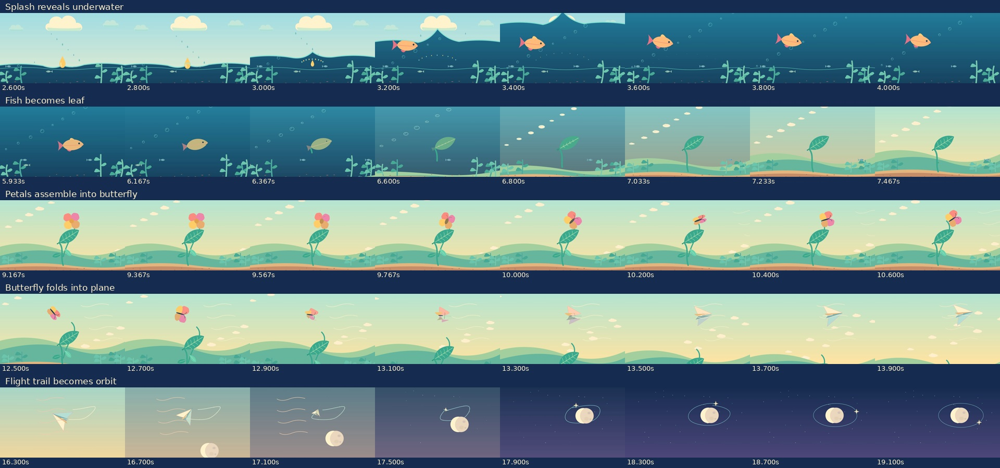

# Six scenes, five animated handoffs — 20-second motion test

**[Download the 1080p MP4](https://github.com/jonaslacandola0617/odd-atom/raw/refs/heads/main/assets/videos/transition-lab/six-scene-transitions-20s.mp4)** · [Poster](../../../assets/videos/transition-lab/six-scene-transitions-poster.png) · [Encoded-file report](delivery.json)

The requested test uses six simple compositions across exactly **20 seconds / 600 frames at 30 fps**, with five overlapping handoffs. It is a wordless visual metaphor made with original authored vector paths in Remotion. The drawing is intentionally simple so the user can judge movement and transitions. No image generation, recycled singularity artwork, narration generation or voice credits were used. There is no on-screen title, branding, numbering or production text.



The proxy is 640 pixels wide at 20 fps and restarts artificially. The downloadable MP4 has the full 1080p/30 fps picture and original synthesized sound effects.

## The six compositions

| Approximate dominant interval | Scene | Animated action and handoff |
|---|---|---|
| 0–3.33 s | Rain over a pond | A larger drop grows, stretches and falls. Its impact produces spray and a moving crest that opens the underwater view. |
| 3.33–6.67 s | Underwater fish | The fish is already swimming as the water reveals it. Its body bends into a leaf; fins/eye retract, veins emerge, and a stalk extends from the former tail root. |
| 6.67–10 s | Growing plant | The leaf remains connected while the stem and side leaves grow. Four petals open, then reorient around a lengthening center to become wings and body. |
| 10–13.33 s | Butterfly in the air | Those same four shapes flap along an authored flight path. They flatten into paper facets while the subject keeps travelling. |
| 13.33–16.67 s | Paper plane | The folded plane banks, follows a curving path and leaves a continuous drawn trail. It contracts into a star as the trail changes its geometry. |
| 16.67–20 s | Night sky | The trail settles into an elliptical orbit around a rising moon. Clouds travel out, stars appear, and the orbiting point slows toward the ending. |

These intervals overlap through the handoffs; there are six dominant compositions and no extra intro/outro scene. Fish-to-plant and plane-to-star are graphic transformations for a transition exercise, not biological or physical explanations.



## How the transitions are constructed

The source is one continuous frame-driven scene graph. The fish/leaf uses one changing outline and attachment point. The four petal paths are retained as butterfly wings and then paper facets; their carrier follows a continuous trajectory. The final trail uses corresponding point samples that deform toward an ellipse, with its endpoint staying attached to the moving star. A moving water clip reveals the fish during the first handoff. Environment layers, bubbles/cloudlets, kelp/grass, particles and wind have their own motion.

There is no whole-composition dissolve between separate scene stills. Sky colors change through the existing field, and layer coverage/reframing supports the object action. Camera movement is not the sole transition mechanism.



The frame review prompted concrete corrections: the stalk now grows from the changing fish's tail root; the plant exits the final sky composition; cloudlets travel off-screen before the night view; and the main fish is revealed by the water coverage instead of appearing after a frame threshold. The source drawing, color grouping and timing remain deliberately simple for this exercise.

The exported file is fully decoded and checked for 600 frames, 20-second duration, H.264 1080p/30 fps picture and AAC 48 kHz stereo sound. These are technical delivery checks. **Creative approval is pending the user's review.** The previously rejected singularity film stays unchanged.

## Source and reproduction

[Animation](../../../src/TransitionLab.tsx) · [Render/assembly](../../../scripts/render_transition_lab.cjs) · [Original sound generator](../../../scripts/transition_lab_sound.py) · [Encoded review](../../../scripts/review_transition_lab.py) · [Reference transition study](../../../references/studies/transitions-2026-10-25/README.md)

```sh
npm run typecheck
npm run sound:transitions     # optional: soundtrack is committed
npm run render:transitions
npm run review:transitions
```

Select `TransitionLabSixScenes` in Remotion Studio. The soundtrack uses deterministic oscillators and filtered noise for drop, splash, bubble, leaf, wing, paper and orbit cues. No sampled commercial soundtrack or speech is included. Frame sheets are spaced samples; the silent GIF is a playback proxy, not a claim of frame-by-frame human viewing or an automatic quality score.
