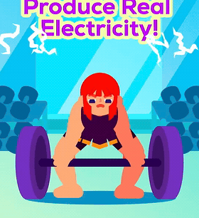
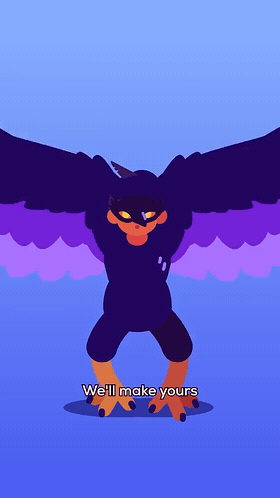
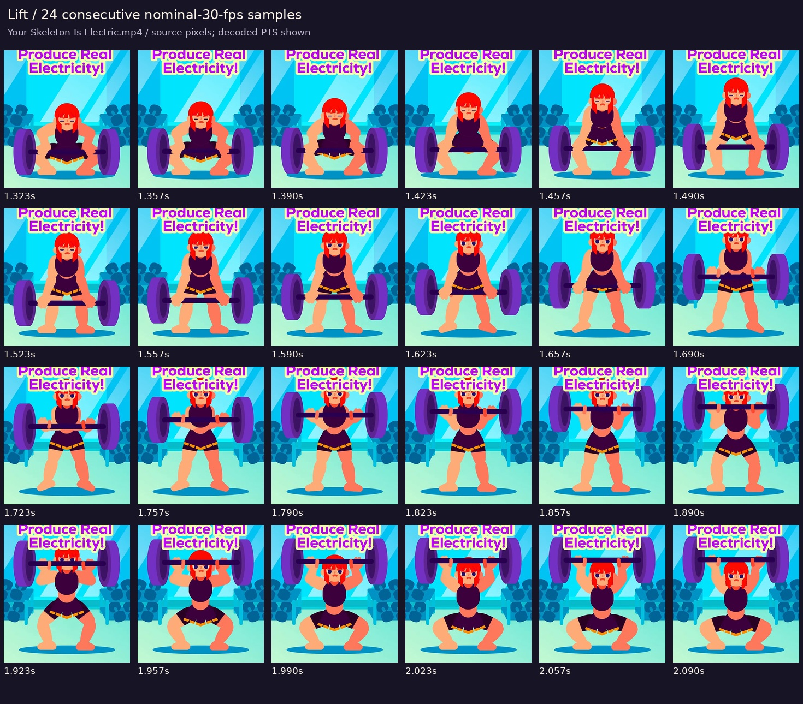
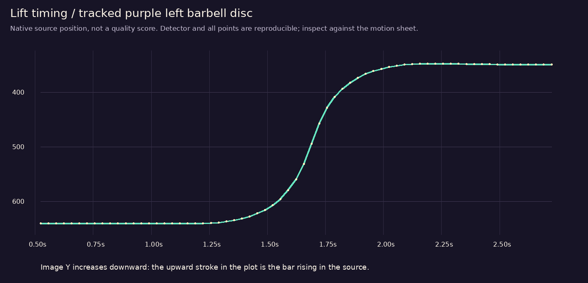
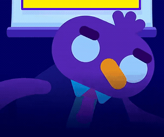
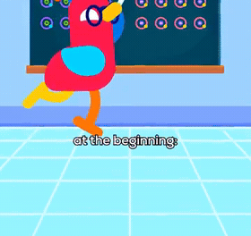
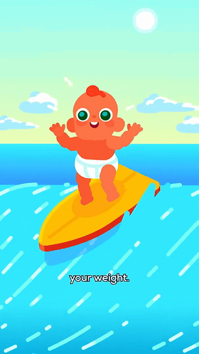
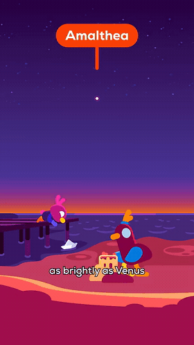

# Character and background motion study

**The artwork has passed.** This study preserves the approved [character sheet](../../../assets/characters/static-test-01.png), [latest film](../../../assets/videos/approved-characters-20s.mp4), character atlases, and background plates. Their hashes are recorded in [visual-lock.json](visual-lock.json); they were checked unchanged before and after the analysis. The next work concerns acting, timing, environmental motion, and narration delivery.

The main finding is **connected, purposeful action with selective background movement**. The reference actors change complete poses and maintain useful contacts with props and the ground. Some backgrounds stay almost completely still. Other scenes have water, effects, or scene travel that moves independently of the actor. Moving every layer is not a requirement.

[Next animation-pass plan](../../../docs/production/motion-next-pass.md) · [Source frames and measurements](measurements.json) · [Official process evidence](process-sources.json)

## Evidence and scope

Eleven short ranges across **all eight uploaded reference videos** were decoded into dense timestamped sheets. A lift also has a 24-sample sequence at the nominal source cadence and a tracked timing curve. Seven short silent GIF excerpts make selected motion visible in this document. These are source-reference excerpts, not animations created for our channel. GIF timing is quantized to centiseconds; the measurement records retain decoded source timestamps.

This is a close study of selected ranges, rather than a claim to have watched every frame of every episode. The compressed portrait uploads support motion analysis, but their cutting rate and composition do not prescribe the pacing of our landscape long-form work. Full YouTube playback remains blocked: both the Loneliness episode and one user-selected episode returned proxy HTTP 403 in this session. No private studio project files were inspected.

The [official production-process page](https://kurzgesagt.org/what-we-do?visit=videos) was accessible. It says that voiceover supplies animation timing, describes a combination of flat 2D animation and 3D elements, and describes a specifically composed soundtrack for each video. That establishes their stated workflow; it does not identify a particular rig, plugin, or software used in these individual shots. The page's content hash and short supporting quotations are retained in [process-sources.json](process-sources.json).

## 1. Characters act through coordinated poses

| Full-body lift | Takeoff |
|---|---|
|  |  |

### The lift: body effort precedes the main prop travel

In **Your Skeleton Is Electric**, approximately **0.5–2.7 s**, the actor prepares low, rises through the knees and hips, brings the bar upward, then bends under the raised weight. The torso, head, elbows, wrists, knees, and feet do not all follow one rigid rotation. The hands remain associated with the bar as the arm configuration changes.



The left disc's visible bounding-box midpoint provides a simple screen-space timing trace. In this sample, the central 80% of the upward movement occurs between approximately **1.523 and 1.890 s**, about **0.367 s / 11 nominal 30-fps frames**. Preparation and the final hold occupy more time than that fast central stroke. These figures describe this lift, not a universal timing recipe for conversation.



The detector and every sample are recorded in the JSON. This measures image-space position, not real weight, force, or a studio animation curve. The disc is partly overlapped by the title near the top; the bounding-box midpoint is used rather than treating the visible color centroid as its physical center.

**Application to Mira and Sol:** begin the action in the body. A meaningful lean, shoulder/chest adjustment, or weight shift should support the gesture. The current flattened torso/legs cannot produce this range by adding more shoulder rotation. Additional matching body poses or articulated/deformable parts are needed.

### Takeoff: preparation, push, separation, then different limb behavior

In **Could Humans Evolve Flight**, **25.4–26.8 s**, the actor first crouches with raised wings, extends into takeoff, separates from the ground shadow, and changes wing and leg poses in flight. The feet and knees change after liftoff while the wings continue their action. That phase difference gives the motion a connected cause and consequence.

[Full timestamped takeoff sheet](sheets/takeoff.jpg)

The visible shape changes are consistent with articulated parts, deformation, and/or replacement drawings. Footage alone cannot tell us which combination was used. The implementation lesson is to preserve the attractive drawing while providing the poses the action requires, rather than forcing a single flattened pose through every movement.

## 2. Acting, facial changes, walking, and holds

| Presenter acting | Walking and changing attention |
|---|---|
|  |  |

- **Presenter, The True Cost of War, 0.4–2.6 s:** head attitude, eye/brow/beak poses, and the two wings/arms change while the presentation screen remains held. The actor carries the energy; moving the set is unnecessary. [Sheet](sheets/presenter.jpg)
- **Walking, Where Did the Antimatter Go_, 36.8–39.0 s:** the legs alternate, the body travels, head/eye direction changes, and the chalk/arm pose changes as the character attends to the board. The held board and floor make the leg action readable. This supplies a useful contrast with sliding a standing silhouette across the image. [Sheet](sheets/walk.jpg)
- **Quiet emotion, The True Cost of War, 56.4–58.3 s:** the crouched pose already communicates distress. Changes in the hands, face, and head are restrained against the quiet field. This is evidence for controlled holds and small acting choices, not a mandate for constant bouncing. [Sheet](sheets/emotion.jpg)
- **Graphic actor, The Deadliest Thing in Your Kitchen, 2.6–3.8 s:** the sugar character coordinates body attitude, eyes, arms, and legs. Simple graphic anatomy still has differentiated acting parts. [Sheet](sheets/sugar.jpg)

The useful principle is an intentional progression of readable poses. For our next performance, the order **look → recognition → body response → hand action → settle** is a proposed acting structure. It should be blocked against the narration and adjusted shot by shot; it is not presented as a measured formula used in every reference shot.

## 3. Are backgrounds animated?

**Sometimes, and selectively.** Separate three things that can look like background animation: movement of the whole view, relative movement of depth layers, and an object/effect changing within the environment.

| Environment with strong local movement | A comparatively held setting |
|---|---|
|  |  |

| Evidence | What can be concluded |
|---|---|
| Presenter screen, 0.5–1.1 s | The screen stays geometrically fixed while the actor changes substantially. A held background is a legitimate solution. |
| Surfing baby, Your Brain Peaked at Birth, 46.4–48.6 s | Water streaks stream across the frame while the board, body, expression, sky and clouds have different behavior. The water motion cannot be explained by one shared transform of the entire picture. |
| Beach/pier, Let's Steal a New Moon, 9.0–10.8 s | The pier, sky, and most sampled water marks are comparatively held while the characters act. This range does not justify claiming that every water mark or star is independently animated. |
| Volcano landscape, Let's Steal a New Moon, 40.4–42.2 s | The landscape travels across the view. Shared scene travel is the dominant visible movement; plume shapes can be inspected separately. The excerpt alone does not establish the exact camera/3D/effects setup. [Loop](loops/volcano.gif) · [Sheet](sheets/volcano.jpg) |
| Psychedelic field, Your Brain on Magic Mushrooms, 24.7–26.1 s | The colored bands change around the central brain. Here the environmental/effect field is part of the explanation, not generic ambience to add to every scene. [Sheet](sheets/psyche.jpg) |
| Orbit diagram, Let's Steal a New Moon, 48.0–50.2 s | The orbiting object, its label, and the fading/changing ring carry explanatory action. This is diagram animation, distinct from making a decorative backdrop move. [Sheet](sheets/orbit.jpg) |

### Check for local motion rather than mistaking a camera move for it

Tracked features were registered to selected anchor-layer regions. The resulting similarity transform accounts for shared translation/rotation/scale. Remaining feature displacement is a diagnostic for relative movement. An anchor layer is not necessarily a physical camera; independently moving clouds, for example, can complicate registration.

| Pair of source frames | Anchor median residual | Tested region median residual | Interpretation |
|---|---:|---:|---|
| Presenter, about 0.523 → 1.123 s | 0.001 px, screen | 47.46 px, actor | Actor changes against a held screen. |
| Surfer, about 46.423 → 46.557 s | 0.30 px, selected sky/cloud features | 46.90 px, water | Water has substantial relative motion; board/actor behavior differs again. |
| Our approved test, 8.300 → 8.600 s | 0.032 px, background | 28.53 px, gesture-arm region | Our camera and arm move, but the background itself behaves like a single fixed plate. |

These are different resolutions and scene contents. They are **not quality scores** and should not be used to rank the size or merit of the actions. Forward/backward track checks and RANSAC reject some unreliable points; they cannot remove every tracking or compression error. The selected gym-edge mask did not yield enough stable anchor points, so no quantitative gym registration result is claimed.

[Presenter regions](sheets/presenter-held-background-regions.jpg) · [Surfer regions](sheets/surfer-sky-water-regions.jpg) · [Our frame regions](sheets/approved-test-background-regions.jpg)

## 4. What this means for the approved artwork

The current character illustration and backgrounds remain the visual baseline. The next pass should improve the **range and timing of the performance**, not replace the drawings.

| Current limit | Motion improvement that preserves the art |
|---|---|
| Flattened torso and legs, with a small global breathing scale | Matching pelvis/torso poses or deformable parts for intentional shifts of weight and posture |
| One rigid illustrated gesture arm rotated at the shoulder | Matching upper arm, forearm, hand and wrist controls, with stable cuff/shoulder overlap; use a new pose drawing for large changes |
| Two main head expressions | A small coherent expression/attention set with controlled transitions, keeping the approved face and hair construction |
| Foreground crowd travel with feet outside the shot | Keep this staging if appropriate; if feet enter view, supply a real leg/contact sequence rather than exposing a sliding cutout |
| Background supplied as one painted plate | Preserve the architecture and palette. Add a few matching movable leaves, soft shadow changes, rising steam, and depth layers only where useful |
| Generic periodic movement | Phrase-specific actions, deliberate holds, asymmetry, and a settle after the gesture |

The existing eye-area blink masks are worth keeping: they protect the hair silhouette. The approved cup grip also stays together with the cup. Steam should emit from the moving cup but rise/dissipate in scene space, rather than rotating as a rigid part of the arm.

## 5. Narration and timing

The official process statement matters here: **“His voiceover provides the timing for the animation team.”** Our next detailed animation should therefore follow a deliberately performed final read, including meaningful stresses and pauses. Caption alignment is useful but does not, by itself, provide acting decisions.

Our current script has **43 words**, with a caption span of **0.228–18.679 s**: approximately **140 words/minute including internal pauses**. Its manifest records a **0.9 tempo adjustment**. These facts do not establish whether the voice sounds convincing or whether it should be faster. [Narration baseline](narration-baseline.json)

For the next test, generate an ElevenLabs read with intended phrasing, emphasis and duration, then align the acting to the performance. Avoid relying on a uniform post-generation slowdown to create the final delivery. Mira and Sol are acting under third-person voiceover; their mouths should react naturally, with phoneme lip sync reserved for actual character dialogue. This study does not claim a subjective listening comparison of the reference soundtracks, nor does it infer voice quality from loudness or word rate.

## Reproduce and review

```sh
python -m pip install --target .cache/motion-study -r references/requirements-motion.txt
python scripts/study_reference_motion.py --source-root /workspace/attachments
```

The eight uploaded files must be available under the chosen source root with the recorded filenames. The script records their hashes, probes, requested and decoded timestamps, and analysis methods. It writes only study artifacts; approved production files are read and hash-checked. The source MP4s are not copied into this study directory.

The next execution plan, including the required character parts and a proposed 20-second acting breakdown, is in [motion-next-pass.md](../../../docs/production/motion-next-pass.md). No replacement film, newly generated voice, or redesigned artwork is being presented as completed by this study.
