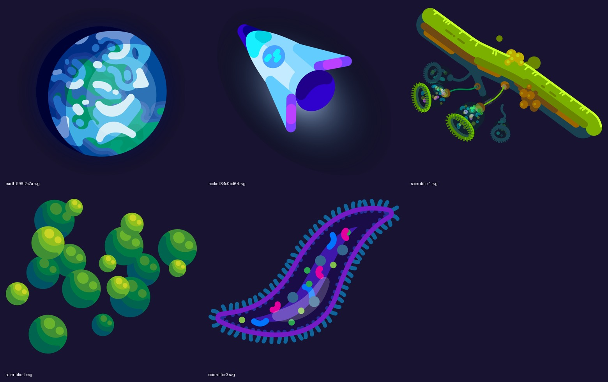
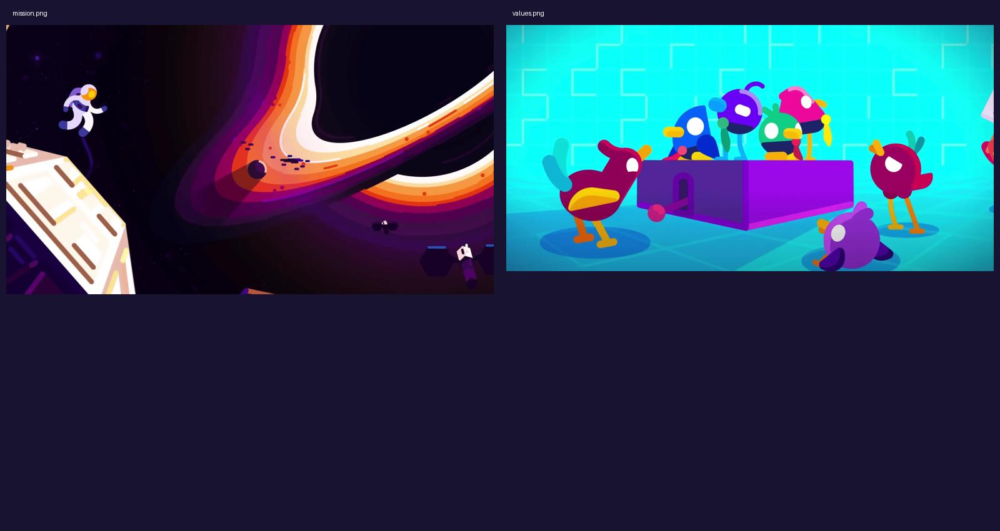
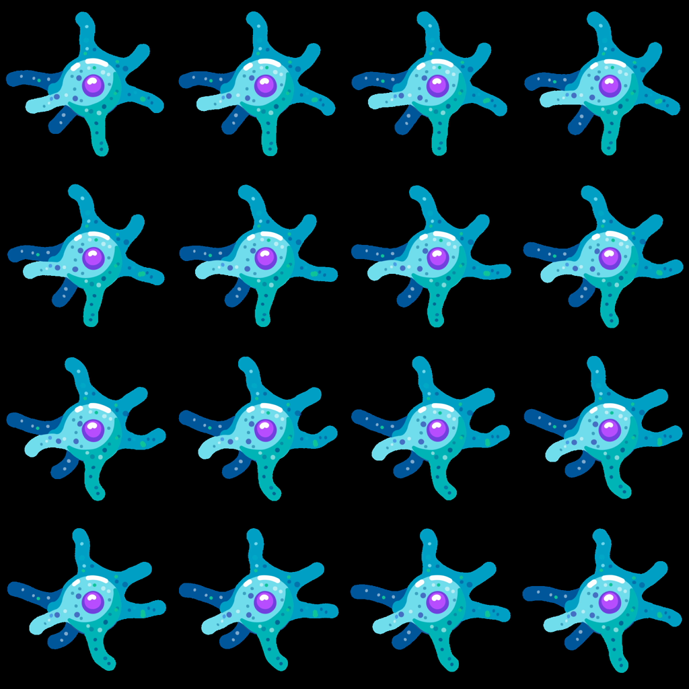

# Official website artwork study — October 23, 2026

These observations come from actual images retrieved from [the official homepage](https://kurzgesagt.org/), [Who we are](https://kurzgesagt.org/who-we-are), and [What we do](https://kurzgesagt.org/what-we-do?visit=videos). The website is now accessible. The three requested YouTube episodes are still blocked and have not been viewed.

Eight original reference files are saved here, with their exact URLs, source pages, byte counts, and SHA-256 hashes in [sources.json](sources.json). They are study references, separate from the original production artwork in `public/assets/`.

## Shape construction and color

- **Earth:** the globe is a circular silhouette filled with broad, rounded, interlocking cloud/land shapes. Overlapping blue planes and a dark crescent establish volume. Fine geographic realism is secondary to a readable globe at small scale.
- **Rocket:** a tapered triangular hull, circular window, and rounded purple fins make a clear silhouette. Pale and saturated cyan regions describe different surfaces; the engine is a dark purple shape with a separate soft glow. It does not depend on a black outline around every part.
- **Green biological structure:** a large diagonal bar anchors smaller hanging forms. Bright yellow-green occupies the upper edge while brown and teal surfaces recede. Secondary circular forms are much smaller, giving the composition a clear size hierarchy.
- **Green spheres:** depth comes from overlapping, bounded regions of teal shadow, green middle color, and yellow-green highlights. Smaller circular highlights repeat the larger shape language. The apparent simplicity contains several deliberate color planes.
- **Purple organism:** a strong curved contour encloses simpler bright organelles. Short blue exterior strokes repeat around the boundary, while the middle stays relatively open. Repeated details follow the organism's structure rather than filling the frame uniformly.

The navy behind these five objects is the study board's background, not evidence that every source asset has a navy background. The SVG assets themselves are transparent.

## Composition and character staging

The mission image places a tiny astronaut and a large cropped foreground structure beside a dominant bright curved astronomical form. The strongest light is concentrated along that curve; much of the surrounding space stays dark. Cropping and the extreme size difference establish scale without explanatory labels.

The values image uses a bright cyan environment with magenta, purple, blue, and green bird characters around a purple central prop. Simple white eye shapes, beaks, short limbs, body tilt, and overlap communicate attention and different poses. Blue ground shadows attach the characters to the scene. This example shows why a universal dark-space palette would miss the range of the artwork.

Neither of these two images contains an explanatory title or narration caption. They cannot establish the channel's title outlines, subtitle timing, or long-form text layouts.

## Short animation sample

[Original website amoeba loop](amoeba.webm): 512 × 512, 30 fps, 4.033 seconds, VP9, no audio stream. The image below samples 16 frames at four frames per second, read left to right, then top to bottom, approximately 0.00–3.75 seconds.

Across the samples, individual extensions bend and change length while the nucleus remains near the central body. The silhouette deforms locally; a single global rotation would not reproduce these poses. Interior dots and colored regions remain associated with the body. The flat blue/cyan regions, violet nucleus, rounded tips, and small highlights remain legible during the deformation. This is a sampled motion inspection, not a continuous playback review or a study of episode editing.

## What the studio says about its process

The official **What we do** page describes five stages: research, script, illustration, voiceover/animation, and music/sound effects. Its text says scenes begin with sketches and visual metaphors, narration supplies animation timing, and the production combines vector and pixel illustration, infographics, 2D animation, and 3D elements. It also describes specifically composed soundtracks. These are statements from the studio's process page, separate from visual observations above.

## Changes this study supports in our original work

1. Build large shapes and their silhouettes before surface decoration. Establish volume with intentional overlapping color regions; use glow selectively.
2. Choose a palette per setting with clear color roles. Preserve value separation between the subject and environment in both dark and bright scenes.
3. Use foreground crops, overlap, and large size differences to explain scale. Concentrate detail near the action and leave breathing room elsewhere.
4. Give original characters distinct poses and deforming parts. A bobbing body with repeated arm swings does not communicate the same range of action.
5. Lock the narration and explanatory sequence before final animation timing. Reserve music and effects for the scene's emotional and physical events.

These are production recommendations derived from this limited website study. Long-form pacing, camera moves, transitions, title treatments, captions, narration performance, and the relationship between music and explanation still require actual episode access. This study does not establish pixel matching or guarantee audience views.
