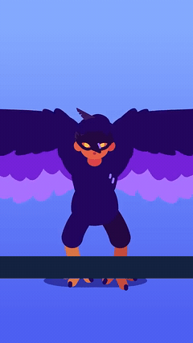
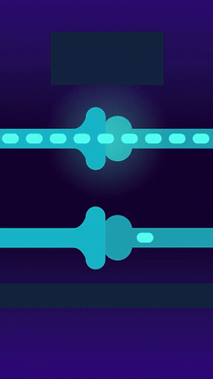
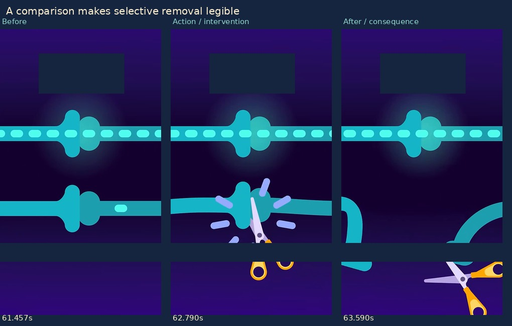
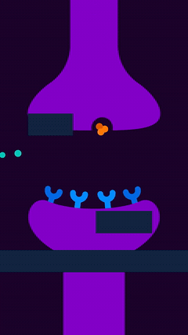
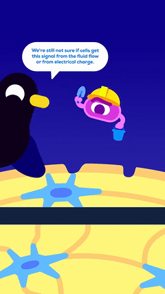
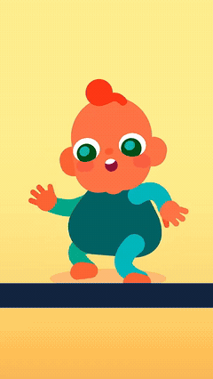
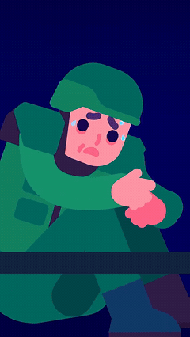
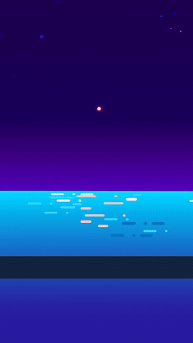
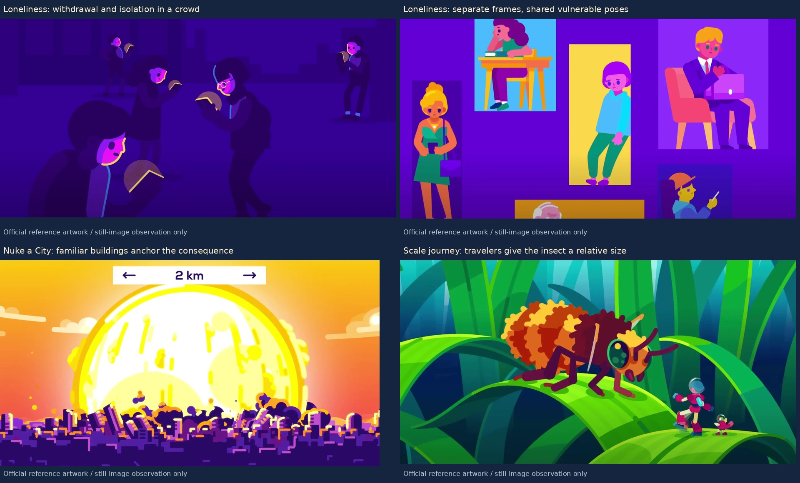

# Animation that explains the story

**The six-scene transition test is approved.** Keep that transition baseline. The next requirement concerns what an animated scene communicates: a viewer should be able to follow the important action, relationship and consequence with the narration muted. A useful starting condition changes because something happens, and the result matters to the next beat.

This study examines **16 selected storytelling intervals and one ambient-motion control across all eight uploaded samples**, with silent, narration-caption-redacted excerpts and before/action/after strips. Four examples also remove the remaining readable diagram labels. Four have 24 consecutive decoded-frame sequences. It also uses **five official Kurzgesagt production/case-study pages and four official still illustrations**. [Case-by-case analysis](case-notes.md) · [Source hashes, masks and timestamps](study.json) · [Official sources](official-sources.json) · [Shot-planning template](storyboard-template.md)

This is an analyst's close reading, not a blinded comprehension experiment. I already know the topics. The claims below distinguish a visible relationship from the exact scientific explanation. Redactions are opaque study masks, can cover nearby artwork, and do not reconstruct hidden pixels. The uploaded originals and all approved production files remain unchanged. The website material supports the studio's stated process and still-image staging; no new full YouTube episode playback is claimed.

## 1. Build an event the viewer can follow

| Preparation → takeoff | Contact → selective disconnection |
|---|---|
|  |  |

In **Could Humans Evolve Flight, 25.32–26.85 s**, the knees bend, the wings change phase, the body pushes upward and the feet separate from a ground shadow. The next pose has a different relationship to the environment: the actor is airborne. The ground/shadow supplies a reference, so motion communicates effort and liftoff. Translating a standing cutout upward would omit the attempt that causes the result.

In **Your Brain Peaked at Birth, 61.15–64.20 s**, two connections share a stable view. Scissors close across the lower one; its ends retract and the upper one remains intact. The viewer can see selective removal. The neighboring connection functions as a comparison, and the gap preserves the consequence. Scientific terms and the biological selection mechanism still need language; literal scissors are a metaphor.



The reusable structure is **starting condition → trigger or attempt → interaction → changed state → implication or response**. It is a planning aid, not five mandatory shots or equal-duration phases. Several steps can happen within one composition.

## 2. Give movement a destination, interaction and result

| Particles attach to particular sites | A worker approaches a particular surface |
|---|---|
|  |  |

In **Your Brain on Magic Mushrooms, 14.60–17.20 s**, particles leave an upper structure, cross a gap and settle at receptor tips. Attachment persists. This makes a directional relationship visible. The words-off version does not establish that the orange particles are psilocin, what activation means, or the biochemical/electrical consequences. It does establish more than an attractive field of drifting dots.

In **Your Skeleton Is Electric, 51.70–54.10 s**, the helmet/bucket gives the cell character a recognizable job, but the storytelling action comes from approaching a selected surface location and bringing the working hand/material to it. A costume alone would not communicate the work. The source also explicitly notes uncertainty about the signal that recruits this work. [Retained uncertainty annotation](repair-uncertainty.png)

For our production, a particle needs an origin, destination and contact behavior. An actor needs a task and an outcome. The changed state must survive long enough to be read. Random orbiting or periodic arm movement cannot supply those relationships.

## 3. Use comparisons and persistent consequences

**Flight food cost, 48.30–52.50 s:** additional burgers arrive on the same plate. The plate anchors the smaller and larger quantities; accumulation makes “more” tangible. The energy comparison, units and time interval still need narration or labels. [Moving example](loops/food-cost.gif)

**Io ring illustration, 44.40–50.60 s:** the orbiting body continues while traces/material accumulate into a ring, which then changes/fades. The environment records an effect of the ongoing action. A finished ring with an orbiting decoration would omit that history. The scenario and physical mechanism require language; the source's not-to-scale note remains important. [Moving example](loops/orbital-ring.gif)

**Material deformation, 10.80–15.70 s in Your Skeleton Is Electric:** hands manipulate the strand ends, the material bows/slides, and the scene introduces differentiated charges and a battery analogy. The force and material response precede the abstraction. Rotation of an unchanged fiber would not explain a response to force. [Moving example](loops/compression.gif)

The useful question is what has become different: quantity, contact, connection, shape, function, access or ability. Keep a stable reference wherever comparison is essential. Let the event change the world instead of resetting it at the next shot.

## 4. Acting and staging make consequences matter

| A failed balance attempt | Vulnerability communicated through a quiet pose |
|---|---|
|  |  |

**Your Brain Peaked at Birth, 37.05–42.55 s:** arms counterbalance, the body leans and the child ends seated. A viewer can follow an attempt and setback. This range does not show a successful retry; “learning has improved” would need a later changed performance, not an inference from movement alone.

**The True Cost of War, 55.10–61.40 s:** a distressed soldier's hunched posture is followed by a child crouched under a desk in a related protective pose. The held body state, small figure and sheltering furniture communicate vulnerability. Repeated idle bouncing would compete with that emotional reading. A later DNA symbol does not independently establish a mechanism of intergenerational trauma.

**Let's Steal a New Moon, 55.10–58.90 s:** observers sit below a quiet sky before fragments and broader auroral curtains arrive. A reserved area of the composition becomes the event. The observers supply a point of view and scale. The timing of arrival creates a payoff; it does not by itself explain the magnetic mechanism. [Moving example](loops/aurora-reveal.gif)

Characters should attend to, attempt, recognize or respond to something. The environment can obstruct an action, record its result or produce the event being observed. A deliberate hold remains useful when the pose and situation already communicate a meaningful state.

## 5. Direct attention in the order the idea needs

The **saffron/head sequence, 30.78–33.45 s**, positions a source above a recipient, shows specks falling, then changes the brain character's expression toward drowsiness. The bowl's motion has a destination and the recipient reacts. The substance and dosage cannot be inferred from that acting alone. [Example](loops/saffron-effect.gif)

The **farmland sequence in The True Cost of War, 17.00–20.40 s**, establishes ordinary work before a large red skull-warning sign enters the foreground. The sign changes the meaning and priority of the setting. The selected range does not show the farmers stopping, a detonation or economic costs. Those must not be invented from the warning. [Example](loops/landmine-threat.gif)

The **research room in Where Did the Antimatter Go_, 42.00–46.20 s**, uses a comic interruption and moving papers, then isolates one bright page as the room recedes. Visual busyness resolves into a single explanatory subject. The gag supports tone/attention; it is not itself an explanation of particle physics. [Example](loops/research-focus.gif)

Stage the cause before asking the viewer to inspect the consequence. Entrances, gaze, contact, contrast and a moment of settling should agree on the next important thing. Detail can remain quiet while the mechanism acts.

## 6. A visual metaphor needs a clear rule and an honest limit

The **brain/filter sequence, 22.30–25.40 s**, starts with containment and removes that boundary before a changing field fills the environment. The metaphor has a changing rule. An already psychedelic background would communicate mood but omit the explanatory change. [Example](loops/filter-opens.gif)

The **matter/antimatter galaxy illustration, 25.00–28.60 s**, establishes separate participants, brings them into contact and locates a luminous consequence at the interaction. The visible causal chain is clear. The labels and surrounding narration are essential: ordinary galaxy collisions must not be represented as this hypothetical annihilation scenario. [Example](loops/collision.gif)

The **fluid-loss illustration in The Deadliest Thing in Your Kitchen, 40.20–44.00 s**, associates departing droplets, a contracting anatomical silhouette and an escalating danger graphic. The visual relationship is bodily loss/harm. The preceding exposure and exact physiological mechanism still require explanation; changing screen size is not a biological measurement. [Example](loops/fluid-loss.gif)

An animation can make an assertion feel convincing. Preserve the difference between an observed process, a simplified mechanism, a metaphor and a hypothesis in both wording and drawing. In the cell-builder example, keep the explicit uncertainty rather than animating one recruitment mechanism as if it were established.

## The control: atmosphere has a different job



In **Let's Steal a New Moon, 15.00–18.40 s**, highlights move over the water and the pier/observer enters the framing. This situates the viewer and gives the setting life. The range does not independently stage a clear high-tide/low-tide comparison or explain the altered-tide claim.

That is a useful production distinction. Removing highlights mostly changes atmosphere. Removing the scissors' contact and the connection's separation removes the explanatory event. Both kinds of motion can coexist, but atmosphere cannot carry a missing mechanism.

## What the official studio resources add

The [official process page](https://kurzgesagt.org/what-we-do?visit=videos) says visual metaphors and scene ideas are considered during sketching before illustration. It also describes researched scripts shaped into stories, recorded voice supplying timing, and specifically composed soundtracks. These statements support planning visual explanations before polishing artwork. They do not prescribe a private rig or a universal timing curve, and they are not a reason to replace the user's Knox recording.

The [Behind the Lies case study](https://kurzgesagt.org/projects/behind-the-lies) describes deliberately simplified stories as gateways to a bigger picture. The useful lesson is to simplify the visible relationship while keeping necessary limits clear.

The [Loneliness case study](https://kurzgesagt.org/projects/loneliness) emphasizes personal connection and careful tone. In its inspected stills, downward gazes, withdrawn postures and separated frames make emotional states legible. The [Nuke a City case study](https://kurzgesagt.org/projects/nuke-a-city) describes making consequences tangible without softening them; recognizable buildings in the inspected blast still anchor scale and stakes. The [Most Extreme Place case study](https://kurzgesagt.org/projects/most-extreme-place) describes a shrinking traveler's journey; the inspected travelers/insect/plant staging makes size relational and experiential.



These are official reference illustrations, not artwork generated by our project. They supply composition evidence only; a still cannot establish motion order, duration or acting changes. [Page hashes, short supporting quotations and scope](official-sources.json)

## How the actions form a story across the uploaded flight clip

The source is a roughly 72-second portrait upload, not a full long-form episode. Its [existing timestamped survey](../transitions-2026-10-25/survey/05.jpg), re-inspected alongside this study's close ranges, shows a useful sequence of roles:

| Approximate interval | Visible material | Role in the developing question |
|---|---|---|
| 0–4 s | Human with wings and the opening question/title | Establish an appealing possibility that invites a test. |
| 4–25 s | Wider wings, exposed skeletal structure, bone comparison, bellows/lungs | Add bodily requirements one at a time, using familiar structure and working mechanisms. |
| 25–29 s | Crouch, push, liftoff and continued wing/leg action | Give an interim visual payoff: the imagined modified actor takes off. |
| 29–44 s | A control molecule/stem, an articulated puppet and the bird's limbs/wings | Introduce another requirement after the apparent success: coordinated control. |
| 44–54 s | Winged fuel can and an accumulating food plate | Attach an ongoing cost to the appealing ability. |
| 54–66 s | A phone gag, wing silhouettes, a large bird and an early aircraft comparison | Broaden the comparison and connect the imagined design to recognizable alternatives. |
| 66 s–end | Human wing imagery and an ordinary human reaction | Return the question to a human perspective instead of ending on a disconnected diagram. |

This is a contextual reading of the visible ordering; the exact anatomical argument, comparison units and conditional conclusion still need words. The important storytelling pattern is that an apparent solution opens the next practical question. The animation does not merely display a catalog of wing assets. For long-form work, preserve that chain of question, demonstration, consequence and next question; the short's cutting density is not a pacing template for nine minutes.

## Applying the study to our work

The approved six-scene test demonstrates that the same shapes and trajectories can survive creative transformations. It was requested as a transition exercise. Keep that work. The next explanatory animation needs a viewer question and a visible causal chain in addition to those handoffs. A fish becoming a leaf can be an engaging graphic bridge; it cannot stand in for a biological mechanism.

For the singularity episode, examples of useful scene intentions are:

| Proposition | Visible event to design | What language must still clarify |
|---|---|---|
| Large-scale separations increase | Keep individual galaxy markers recognizable while several separations increase against a shared spatial reference. Repeat from another marked viewpoint so no single launch site is privileged. | The cosmological interpretation, model assumptions and distinction from objects simply flying through a fixed room. |
| Opaque plasma becomes transparent | Follow a highlighted light packet through repeated scattering, then let it travel through as free-electron scattering becomes less effective after recombination. Show the changed interaction. | The simplified representation, chronology, temperatures and why the same ancient light is observed as microwaves today. |
| Classical extrapolation reaches a limit | Put the model on a visible chart/board. Separate the tested region from extrapolation and let the calculation/path fail to provide a valid continuation. | An infinity in a classical calculation does not establish an observed physical seed or prove that all existence began there. |

These are production proposals, not completed scenes or newly validated scientific research. Use the existing narration's timing and preserve the distinction between supported history and hypothetical earlier scenarios.

Before finishing a shot, write what the viewer should understand, what changes on screen, what causes that change, and which details still need words. Then review the shot muted with narration captions hidden. If its explanation disappears while decorative motion remains, revise the action/staging before adding polish. Preserve the approved drawing quality and transition mechanics throughout. The [template](storyboard-template.md) makes those decisions concrete without adding production labels to the video.

## Evidence and reproduction

```sh
python -m pip install --target .cache/motion-study -r references/requirements-motion.txt
python scripts/study_visual_storytelling.py --source-root /workspace/attachments
```

The source filenames/hashes must match the eight uploaded clips. The script produces redacted study excerpts, timestamped sheets, four consecutive-frame sequences, story strips and official-source records. Raw webpage caches stay in ignored `out/`. It checks the approved transition MP4, rejected singularity MP4, approved drawings and original Knox recording unchanged. No replacement film or speech is generated by this study.
