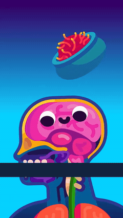
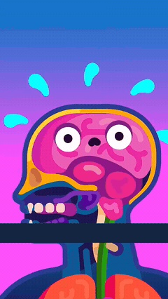
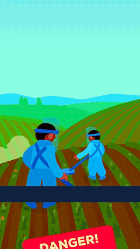
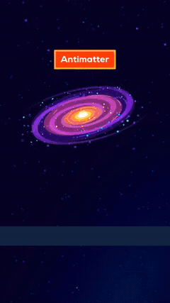
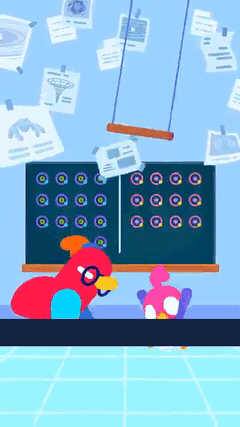
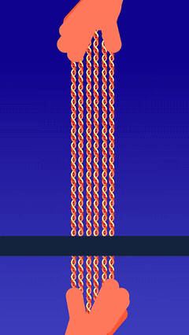
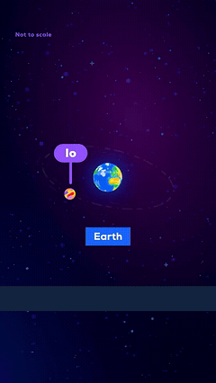

# Case-by-case visual-story notes

Read these as analyst observations of selected source intervals, not measured audience comprehension. Narration captions are redacted in previews. Four cases also remove their remaining readable diagram labels; other cases retain scientific labels and explicitly list what still needs language. Masks can obscure other source pixels in the same rectangles.

## 1. Preparation makes the takeoff understandable

**Source 5 / 25.32–26.85 s** · Intent, effort, contact and consequence

| State | Observed staging/action |
|---|---|
| Before | The actor is grounded over a shadow, with bent knees and raised wings. |
| Intervention/action | Knees extend and the wing stroke changes; feet separate from the ground shadow. |
| Result | The actor is visibly airborne, with the legs and wings continuing different phases of movement. |

**Visible relationship:** A winged character prepares and takes off; the movement takes effort rather than being a rigid upward slide.

**Still needs language/context:** Which anatomical changes could make human flight possible, and the conditional scientific argument surrounding this imagined character.

**What the action adds:** A floating final pose would omit the push, effort and change of contact that explain how the actor left the ground.

**Production lesson:** Stage a readable intention, physical action and changed relationship to the environment. Keep a ground/contact reference.

[Before/action/after strip](story-strips/takeoff.jpg) · [Timestamped samples](sheets/takeoff.jpg)

## 2. A moving particle reaches a specific attachment site

**Source 2 / 14.60–17.20 s** · Mechanism through destination and contact

| State | Observed staging/action |
|---|---|
| Before | Particle groups are separated from a row of branching receptor shapes. |
| Intervention/action | Orange particles leave the upper structure, cross the gap and settle at particular receptor tips; turquoise particles continue approaching. |
| Result | Some receptor tips retain attached particles instead of every particle merely drifting past. |

**Visible relationship:** Small objects travel to and attach at specific sites on another structure.

**Still needs language/context:** The identities psilocin/serotonin, receptor activation and the neurological consequences. Attachment alone does not visibly prove an electrical or biochemical signal.

**What the action adds:** A field of colored dots beside a membrane would omit the origin, direction and binding event.

**Production lesson:** Give particles a source, destination, contact rule and persistent post-contact state.

[Before/action/after strip](story-strips/receptor-fit.jpg) · [Timestamped samples](sheets/receptor-fit.jpg)

## 3. A comparison makes selective removal legible

**Source 7 / 61.15–64.20 s** · Stable control, intervention and consequence

| State | Observed staging/action |
|---|---|
| Before | Two parallel connections occupy a stable view; the upper one carries repeated bright signal marks. |
| Intervention/action | Scissors enter and close across the lower connection. |
| Result | Its ends retract into a visible gap while the upper connection remains continuous. |

**Visible relationship:** One connection is deliberately severed while its neighbor is preserved.

**Still needs language/context:** That these represent synapses, which activity-dependent biological processes select them, and why literal scissors are a metaphor.

**What the action adds:** Two final lines, one broken, would not explain the intervention or its order. Removing the intact upper comparison would weaken the selectivity.

**Production lesson:** Hold one reference unchanged while the explanatory variable changes. Preserve the resulting gap.

[Before/action/after strip](story-strips/pruning.jpg) · [Timestamped samples](sheets/pruning.jpg)

## 4. Acting makes struggling with balance visible

**Source 7 / 37.05–42.55 s** · Attempt, instability and setback

| State | Observed staging/action |
|---|---|
| Before | The baby is upright with a small footprint and arms spread for balance. |
| Intervention/action | The body leans, the limbs counterbalance, and an internal stylized view briefly emphasizes the body/brain relationship. |
| Result | The baby ends seated on the ground, with a changed facial expression. |

**Visible relationship:** The child attempts to balance or move and loses balance.

**Still needs language/context:** That this illustrates learning and a mental challenge. This selected range does not show a successful retry or prove improvement.

**What the action adds:** An isolated sitting baby would not communicate the failed attempt that led to the seated pose.

**Production lesson:** Use whole-body poses and balance changes to communicate an attempt and outcome. Show a later successful attempt if the intended proposition is learning.

[Before/action/after strip](story-strips/balance-fall.jpg) · [Timestamped samples](sheets/balance-fall.jpg)

## 5. Delivery followed by reaction gives the prop a purpose

**Source 1 / 30.78–33.45 s** · Causal path and emotional consequence

| State | Observed staging/action |
|---|---|
| Before | A bowl is positioned above an anatomical head with an alert-looking brain character. |
| Intervention/action | The bowl tilts and specks fall toward the brain. |
| Result | The brain's expression becomes drowsy and conventional sleep marks appear. |

**Visible relationship:** Something delivered from the bowl is associated with a sleepy reaction. The sleep marks contribute an established visual convention.

**Still needs language/context:** The substance, its chemical constituent, dose and medical interpretation. The cartoon is not a complete mechanism or dosing instruction.

**What the action adds:** Floating a bowl beside a head would not establish delivery or a change in the recipient.

**Production lesson:** Connect source to recipient, then change the recipient's state. Movement should produce a consequence.

[Before/action/after strip](story-strips/saffron-effect.jpg) · [Timestamped samples](sheets/saffron-effect.jpg)

## 6. Anatomical state change communicates danger

**Source 1 / 40.20–44.00 s** · Loss, deformation and escalation

| State | Observed staging/action |
|---|---|
| Before | The brain/head is shown with visible water-drop symbols nearby. |
| Intervention/action | Droplets depart and the anatomical head/brain silhouette contracts. |
| Result | Expressions and a red descending graphic change the scene's meaning toward harm. |

**Visible relationship:** Loss of fluid is associated with a worsening bodily state.

**Still needs language/context:** The prior salt exposure, osmotic mechanism, exact anatomical changes and clinical consequences. Screen-space shrinking alone is not a measurement of biological tissue loss.

**What the action adds:** An intact head with decorative droplets would not communicate loss and deterioration.

**Production lesson:** Make the changed quantity and consequence visible against stable references; use color escalation after the physical change is established.

[Before/action/after strip](story-strips/fluid-loss.jpg) · [Timestamped samples](sheets/fluid-loss.jpg)

## 7. Changing the boundary changes the experience

**Source 2 / 22.30–25.40 s** · Visual metaphor for a hidden process

| State | Observed staging/action |
|---|---|
| Before | A small brain remains inside a circular boundary. |
| Intervention/action | The boundary shrinks/disappears; the brain remains and a colored field grows outward. |
| Result | The environment is filled by changing bands around the same brain. |

**Visible relationship:** A contained subject becomes exposed to, or surrounded by, a much larger changing field.

**Still needs language/context:** The specific perceptual-filter claim and its limits. This is an explanatory metaphor, not literal colored anatomy.

**What the action adds:** A psychedelic background alone would communicate mood without the prior containment and its removal.

**Production lesson:** Give a metaphor a rule, show that rule changing, then let the changed rule affect the scene.

[Before/action/after strip](story-strips/filter-opens.jpg) · [Timestamped samples](sheets/filter-opens.jpg)

## 8. The environment introduces a threat to ordinary work

**Source 3 / 17.00–20.40 s** · Stake, interruption and attention hierarchy

| State | Observed staging/action |
|---|---|
| Before | Farmers work recognizable rows in a cultivated field. |
| Intervention/action | A large red skull-warning sign enters the foreground and takes visual priority. |
| Result | A small land parcel/ground diagram replaces the field to introduce the next explanation. |

**Visible relationship:** An ordinary activity takes place in a dangerous setting. The warning icon supplies a familiar threat cue.

**Still needs language/context:** The exact hidden hazard and economic costs. This range does not visibly show the farmers stopping or a mine detonating.

**What the action adds:** A warning already present from the first frame would weaken the reveal of danger; the red foreground entrance changes what the viewer attends to.

**Production lesson:** Establish normal activity before introducing the threat. Let foreground scale/value redirect attention for a reason.

[Before/action/after strip](story-strips/landmine-threat.jpg) · [Timestamped samples](sheets/landmine-threat.jpg)

## 9. Matching vulnerable poses connect human consequences

**Source 3 / 55.10–61.40 s** · Empathy, stillness and a visual rhyme

| State | Observed staging/action |
|---|---|
| Before | A soldier sits hunched with clasped hands, a distressed face and a weapon on the ground. |
| Intervention/action | A cut introduces a child crouched under a desk in a similarly protective pose; later a DNA symbol is overlaid. |
| Result | The child remains small and sheltered by the furniture, holding the vulnerable state. |

**Visible relationship:** Distress and protective behavior connect two human situations. The quiet staging makes vulnerability readable.

**Still needs language/context:** The statistical claims and any asserted intergenerational mechanism. A DNA symbol alone cannot establish how trauma is transmitted.

**What the action adds:** Removing purposeful pose/expression would weaken empathy. Adding constant idle bouncing would compete with the held emotional state.

**Production lesson:** A deliberate hold can carry a story. Match meaningful body states across shots, and keep the scientific explanation distinct from the emotional analogy.

[Before/action/after strip](story-strips/fear-rhyme.jpg) · [Timestamped samples](sheets/fear-rhyme.jpg)

## 10. Contact creates the consequence

**Source 4 / 25.00–28.60 s** · Approach, collision and changed state

| State | Observed staging/action |
|---|---|
| Before | Two differently colored galaxy-like systems occupy separate positions. |
| Intervention/action | The lower system approaches and overlaps the upper one; the contact becomes increasingly luminous. |
| Result | A bright emission/burst representation occupies the collision location. |

**Visible relationship:** The two systems meeting is associated with a large energetic consequence.

**Still needs language/context:** Matter versus antimatter and the hypothetical nature of this scenario. Ordinary galaxy collisions must not be implied to annihilate this way.

**What the action adds:** A standalone burst would omit what interacted to produce the illustrated consequence.

**Production lesson:** Show distinct participants before contact, time the response to the interaction, and preserve where it happened.

[Before/action/after strip](story-strips/collision.jpg) · [Timestamped samples](sheets/collision.jpg)

## 11. A busy gag resolves into one explanation

**Source 4 / 42.00–46.20 s** · Comic interruption followed by focus

| State | Observed staging/action |
|---|---|
| Before | The researcher and a smaller bird share a room with many papers; the smaller bird has fallen from its perch. |
| Intervention/action | Papers move through the foreground and obscure the actors; one page separates and stays bright as the room recedes. |
| Result | A single model page becomes the next focal subject. |

**Visible relationship:** A chaotic interruption is followed by attention narrowing to one document.

**Still needs language/context:** What the scientific problem is and what the selected page's model asserts. The gag is not itself a physics mechanism.

**What the action adds:** A wall of equally prominent paper images would provide neither the interruption nor the selection that guides attention.

**Production lesson:** Resolve visual busyness into one relevant object. Use humor to support attention and tone, with a readable return to the explanation.

[Before/action/after strip](story-strips/research-focus.jpg) · [Timestamped samples](sheets/research-focus.jpg)

## 12. An increasing pile makes quantity tangible

**Source 5 / 48.30–52.50 s** · Concrete accumulation and comparison

| State | Observed staging/action |
|---|---|
| Before | A plate receives food, forming a smaller burger grouping. |
| Intervention/action | Additional burgers drop into the same plate/stack. |
| Result | A larger food pile remains, emphasized by a radial graphic. |

**Visible relationship:** More food is required/being accumulated than in the earlier state; the plate is a stable comparison anchor.

**Still needs language/context:** Why food represents flight energy, the comparison with running, time interval and calorie equivalences. A growing pile alone does not specify those units.

**What the action adds:** One final food illustration would omit the smaller baseline and the act of adding more.

**Production lesson:** Show quantity changing on the same anchor instead of replacing one large number with another.

[Before/action/after strip](story-strips/food-cost.jpg) · [Timestamped samples](sheets/food-cost.jpg)

## 13. Manipulation changes the material before the analogy

**Source 6 / 10.80–15.70 s** · Mechanical action followed by an abstract consequence

| State | Observed staging/action |
|---|---|
| Before | Hands hold the ends of several long molecular-strand illustrations. |
| Intervention/action | The strands bow and slide relative to one another as their ends are manipulated. |
| Result | A fiber with differentiated sides/charge labels and an electrical mark leads into a battery analogy. |

**Visible relationship:** Mechanical manipulation deforms an organized material, and an electrical association follows.

**Still needs language/context:** Collagen, piezoelectricity, charge separation and the limits of the battery analogy. The labeled signs carry essential polarity information.

**What the action adds:** A rotating finished fiber would not demonstrate the material responding to manipulation.

**Production lesson:** Animate the material response to a specific force; use metaphor after the causal action, not as a replacement for it.

[Before/action/after strip](story-strips/compression.jpg) · [Timestamped samples](sheets/compression.jpg)

## 14. A builder metaphor gives cellular work an intention

**Source 6 / 51.70–54.10 s** · Agent, destination and localized work

| State | Observed staging/action |
|---|---|
| Before | A helmeted cell character with a bucket approaches the exposed bone surface. |
| Intervention/action | It moves to a specific surface location and brings its working hand/material toward the edge. |
| Result | Work is concentrated at that edge rather than being a decorative orbit around the diagram. |

**Visible relationship:** A builder-like agent is working on a particular surface.

**Still needs language/context:** Osteoblast identity, the material being deposited and the signal that recruits this work. An earlier speech bubble explicitly says the signal may involve fluid flow or electrical charge; the mechanism must not be presented as settled.

**What the action adds:** A helmeted cell floating beside bone would retain the costume but omit the destination and work.

**Production lesson:** Design the character's action around its job. Preserve explicit uncertainty instead of making a smooth animation imply a solved mechanism.

[Before/action/after strip](story-strips/repair-worker.jpg) · [Timestamped samples](sheets/repair-worker.jpg)

## 15. An orbit accumulates a visible consequence

**Source 8 / 44.40–50.60 s** · Persistent trace and changing environment

| State | Observed staging/action |
|---|---|
| Before | An orbiting body travels around Earth with relatively little visible ring material. |
| Intervention/action | Tracks/material accumulate around the same orbit as the body continues moving. |
| Result | A ring becomes visible, changes/fades, and the orbital subject persists. |

**Visible relationship:** Repeated travel is associated with an accumulating ring and its later change.

**Still needs language/context:** Io, sulfur, the proposed scenario, ring persistence and physical mechanism. The source's not-to-scale note is important and remains visible.

**What the action adds:** A rotating moon beside an already finished ring would omit accumulation and change over time.

**Production lesson:** Let an object's action leave an explanatory trace in the environment, with an initial state and persistent result.

[Before/action/after strip](story-strips/orbital-ring.jpg) · [Timestamped samples](sheets/orbital-ring.jpg)

## 16. An expectation hold prepares an environmental payoff

**Source 8 / 55.10–58.90 s** · Attention, anticipation and shared wonder

| State | Observed staging/action |
|---|---|
| Before | Observers sit beneath a large quiet sky. |
| Intervention/action | A few colored fragments appear overhead before wider auroral curtains spread through the sky. |
| Result | The sky has become the main event while the observers give it a human scale and point of view. |

**Visible relationship:** People are watching a striking sky event develop.

**Still needs language/context:** How particles from the hypothetical moon scenario would produce it. A beautiful aurora does not independently explain the preceding magnetic interaction.

**What the action adds:** A fully lit sky from the outset would omit expectation, arrival and reveal.

**Production lesson:** Reserve a quiet state so an environmental change can become an event. Keep the observer's attention aligned with it.

[Before/action/after strip](story-strips/aurora-reveal.jpg) · [Timestamped samples](sheets/aurora-reveal.jpg)

## 17. Control: moving water does not independently explain tides

**Source 8 / 15.00–18.40 s** · Boundary between atmosphere and explanation · ambient-motion control

| State | Observed staging/action |
|---|---|
| Before | A stylized ocean and night sky occupy the scene. |
| Intervention/action | Water highlights move and a pier/observer enters the framing. |
| Result | The viewer has a situated ocean view, but this selected range does not stage a clear repeated high/low tide comparison. |

**Visible relationship:** A person is by an ocean with moving highlights.

**Still needs language/context:** The moon's density and the claim about altered tides. Those facts cannot be recovered from the ambient motion in this range alone.

**What the action adds:** Removing the highlights reduces atmosphere but does not remove a visually demonstrated tide mechanism, because one is not established in this interval.

**Production lesson:** Atmosphere has a legitimate role, but it cannot substitute for the event or comparison that must teach the intended idea.

[Before/action/after strip](story-strips/water-control.jpg) · [Timestamped samples](sheets/water-control.jpg)
