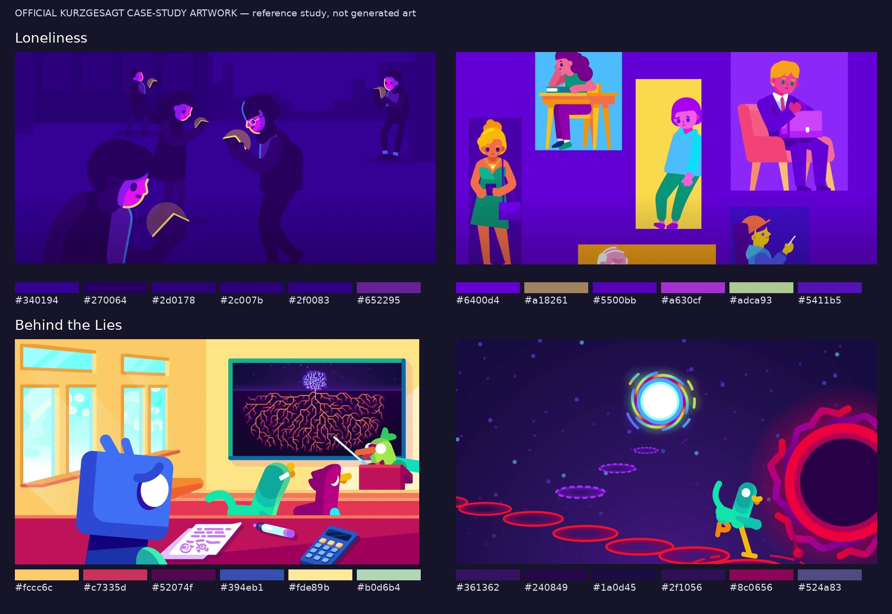
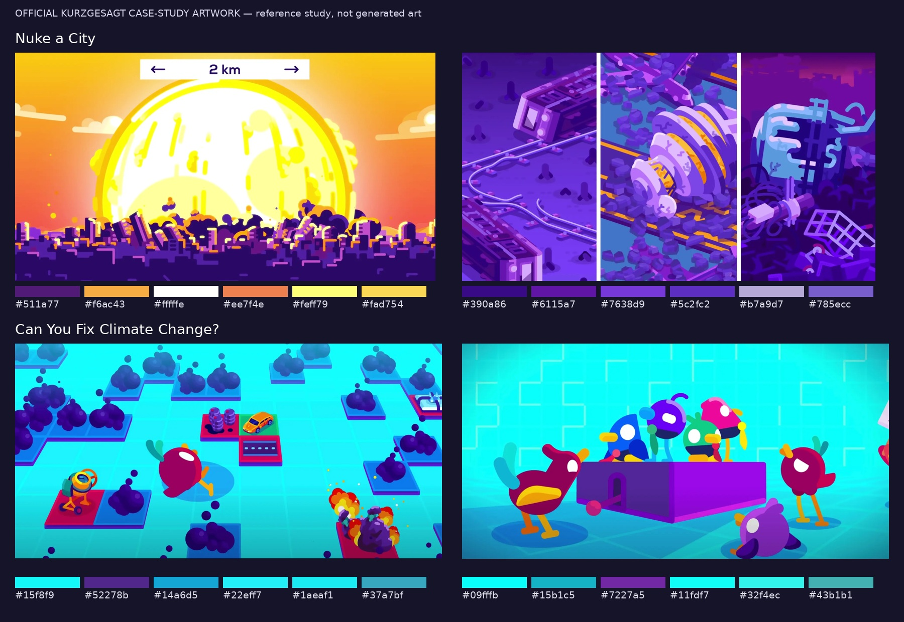
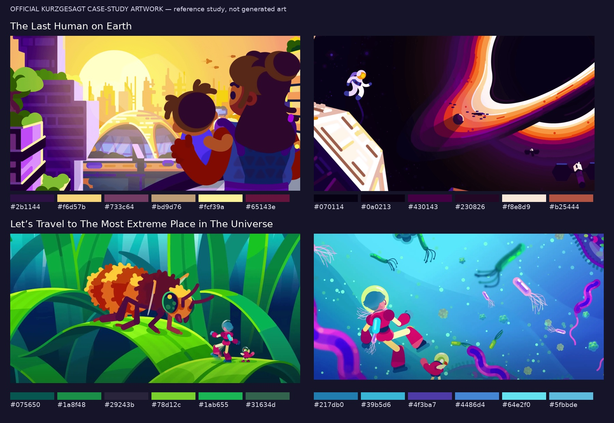

# Beyond space and biology: six episode case studies

This study broadens the reference range to human emotion, communication, war, collective action, and the future of society. It examines **six official episode case-study pages and 12 accompanying images**. Five selections center human or societal questions; a micro-world journey provides a comparison with the earlier science-art study.

**Authorship:** every downloaded image below is official Kurzgesagt artwork. These are reference images, not graphics generated by Odd Atom. The comparison boards and written analysis were assembled for this project.

**Access and evidence:** YouTube channel and episode requests still failed at the environment proxy with HTTP 403 during this session. Full episodes were not downloaded or watched. The official website's case-study pages were accessible. Their images support observations about drawing, composition, color, poses, and visible text; their written descriptions support attributed observations about the studio's stated approach. They do not establish shot order, timing, camera movement, narration delivery, music, or sound effects.

[Sources and original image downloads](sources.json) record the exact page URLs, official YouTube IDs, image URLs, dimensions, byte counts, and SHA-256 hashes. Image numbering follows each page's HTML order, not an inferred order in the episode. The website's case-study titles are used here; they may differ from current YouTube titles. Two subjects were already represented by images in the earlier website study: the group of birds around a prop and the astronaut beside a bright astronomical curve.

## Selection and coverage

| Official case study | Expanded subject | What was inspected | Full episode |
|---|---|---|---|
| [Loneliness](https://kurzgesagt.org/projects/loneliness) | Relationships, emotion, modern life | Case-study text; two images of people | Not viewed |
| [Behind the Lies](https://kurzgesagt.org/projects/behind-the-lies) | Trust, misinformation, explaining ideas | Case-study text; classroom and abstract journey images | Not viewed |
| [Nuke a City](https://kurzgesagt.org/projects/nuke-a-city) | War, humanitarian consequences, infrastructure | Case-study text; city-scale event and infrastructure images | Not viewed |
| [Can You Fix Climate Change?](https://kurzgesagt.org/projects/can-you-fix-climate-change) | Collective action, personal agency, systems | Case-study text; tiled world and group-prop images | Not viewed |
| [The Last Human on Earth](https://kurzgesagt.org/projects/the-last-human) | Future generations, hope, long-term choices | Case-study text; family/city and space images | Not viewed |
| [Let's Travel to The Most Extreme Place in The Universe](https://kurzgesagt.org/projects/most-extreme-place) | Exploration and changes of scale | Case-study text; insect and micro-world images | Not viewed |

## 1. Emotion and trust

### Loneliness

**Observed in image 01:** several human figures occupy the same urban environment but remain separated by gaps. The foreground figure is cropped and much larger than the distant figures. Heads tilt, shoulders round, and hands sit close to the torso. The environment and clothing share deep purple values; small pink and warm yellow facial/hand-area accents carry much of the contrast. There is no explanatory heading needed to establish a human situation.

**Observed in image 02:** people appear in distinct rectangular vignettes: a desk, a chair and laptop, a standing person, and other everyday situations. Cyan, yellow, and pink panels separate these situations from the shared purple field. Hair silhouettes, clothing, body proportions, poses, and props vary. This is a broader human cast than one repeated mascot with swapped colors.

**Stated by the studio:** the case study describes balancing facts with a deeply personal subject and says getting the tone right took two years. This is production context from its page, not a timing measurement from the episode.

**Application to original work:** begin an emotional explanation with a recognizable situation and a readable pose. Use distance, grouping, overlap, and gaze to express the relationship before adding scientific diagrams. For a montage of different experiences, give each vignette its own staging and accent color while retaining a shared environment color.

**Not established:** how the vignettes enter, whether the first image follows the second, how long a pose holds, or how the narrator addresses the viewer.

### Behind the Lies

**Observed in image 01:** a warm yellow classroom contains a large blue bird in the foreground, smaller classmates, and a teacher pointing toward a dark board. A dense branching diagram is confined to the board. Desks, windows, a sheet of paper, a pen, and a calculator give the explanation a familiar setting. Cropped foreground objects and differences in character size create depth without rendering every surface realistically.

**Observed in image 02:** a green bird stands among red elliptical rings leading into depth. A large red/magenta circular form is cropped at the right edge; a bright white/cyan circular form sits farther above. Most of the image stays dark purple. Brightness, repeated shapes, and the character's placement organize an abstract idea into a spatial situation. This does not establish what each ring means without the episode.

**Stated by the studio:** the page describes the use of simplified explanations as an entry point to a more complex picture and identifies the TRESCA communication project.

**Application to original work:** use a familiar setting to introduce an abstract question, then construct a visual metaphor with a consistent spatial rule. Keep complexity on the object being discussed, as the classroom image does with its board. Avoid making every background object equally busy.

**Not established:** whether the two images form a transition, how simplification is qualified in the spoken script, or what sound accompanies the abstract scene.

## 2. Consequences and collective action

### Nuke a City

**Observed in image 01:** an almost-white and yellow circular event dominates a city skyline. Orange surrounds it; deep purple buildings and dark cloud shapes anchor the lower frame. Repeated architectural rectangles establish a city before small detail is read. A plain white strip with arrows and **2 km** supplies a direct size comparison. This is a functional diagram label, distinct from a decorative opening title.

**Observed in image 02:** three narrow panels show damaged infrastructure and equipment. Diagonal rails, tilted objects, broken forms, and scattered fragments do much of the explanatory work. A restricted purple/lavender family keeps the panels coherent; lighter edges separate overlapping objects. The scene can communicate loss of essential systems through objects and environments rather than relying only on facial acting.

**Stated by the studio:** the case study identifies the ICRC collaboration and describes the difficulty of explaining devastating consequences through visually appealing work without softening their significance.

**Application to original work:** make scale readable, then connect the event to familiar systems people depend on. Use a limited palette to prevent an aftermath scene from becoming an unreadable collection of fragments. Include a numerical label when the number changes the viewer's understanding.

**Not established:** the event's animated expansion, the sequence of consequences, exact scientific values beyond what the still visibly labels, or the soundtrack. The images are not a basis for independently validating the episode's factual claims.

### Can You Fix Climate Change?

**Observed in image 01:** a bright cyan field contains repeated raised tiles, dark rounded cloud symbols, small everyday/industrial objects, and a bird. An angled ground grid creates a common perspective. Repetition makes many items feel like parts of one system. Red/magenta tile accents and warm small objects stand out from the cyan environment and cool cloud shapes.

**Observed in image 02:** several birds gather around one large purple prop with a crank-like element. Their body tilts, wing poses, and different heights vary. Shared ground shadows and overlap attach them to the same setting. The large prop offers a common focal point for a group scene.

**Stated by the studio:** its description emphasizes interconnected causes and the inadequacy of a single solution, and places the work in a larger climate series. That framing is available from the text; it has not been reconstructed from unseen narration.

**Application to original work:** explain relationships with repeated units and consistent visual symbols. Distinguish individual actions, shared machinery, and system-wide changes by staging and scale. Show a group working around a meaningful object rather than merely lining up characters beside labels.

**Not established:** the rules of the tiles in the film, which elements animate first, or whether any specific character action changes an outcome.

## 3. Hope, people, and unfamiliar worlds

### The Last Human on Earth

**Observed in image 01:** an adult holding a child occupies the right foreground, seen from behind and looking into a large city. Warm yellow light surrounds the skyline; dark plum hair and clothing separate the foreground figures from that light. Green planted areas, layered buildings, a domed structure, and rails establish a designed future setting. The image gives a human viewpoint to an otherwise very large subject.

**Observed in image 02:** a tiny astronaut and cropped foreground structure sit beside an enormous bright curved astronomical form. A broad dark field preserves the contrast of the pale inner band and orange/violet outer bands. The human-to-environment size difference supplies a scale cue. This image was already inspected in the earlier website study, where it served as the site's mission illustration.

**Stated by the studio:** the page identifies Open Philanthropy support, possible futures, decisions affecting descendants, and an explicitly hopeful outlook. These are the case study's stated aims, not conclusions about the episode's full argument.

**Application to original work:** give an abstract future a person who has a stake in it. A warm inhabited city and a dark astronomical scene can belong to the same broader visual language. Preserve continuity through shape construction, value hierarchy, and a human viewpoint rather than forcing one palette onto every setting.

**Not established:** the episode's philosophical assumptions, which futures it compares, the order of these scenes, or the way music develops its sense of hope.

### Let's Travel to The Most Extreme Place in The Universe

**Observed in image 01:** a large insect faces a much smaller suited traveler and companion on a broad blade of grass. Overlapping green blades form foreground, middle, and distant layers. The insect's orange/brown body contrasts with the green setting; repeated dark teal shapes recede behind it. A familiar blade becomes a landscape through relative size and framing.

**Observed in image 02:** the traveler appears among differently sized organisms and particles in a cyan/blue environment. Large cropped organisms frame the edges; smaller ones occupy the distance. Magenta/pink body accents keep the traveler readable. Some edge forms are soft, while the focal character remains clearer, so the image is not uniformly hard-edged vector art.

**Stated by the studio:** the page describes following a traveler through progressively smaller environments to make changes of scale intuitive.

**Application to original work:** retain a recognizable traveler or reference object when changing scale. Redesign the environment's composition and relative object sizes instead of relying solely on a camera zoom. The same approach could explain institutions, networks, or historical systems with a carefully chosen human reference.

**Not established:** the actual scale transition, zoom speed, cut points, or how scientific regimes change in the narration.

## What this adds to our palette

The broader palette is more than additional colors. It includes human interiors, workplaces, cities, public infrastructure, families, visual arguments, and collective action. The recurring craft is clear silhouettes, selective contrast, recognizable relationships, coherent props, and deliberate differences in scale.

The [visual vocabulary and original-production guide](visual-vocabulary.md) turns these observations into practical drawing and staging decisions. [Next-study coverage](next-study.md) records the missing motion/audio questions and a wider thematic selection. Proposed production choices are marked separately from observed source details.

### About the color swatches

Each image on the boards has six approximate dominant colors from a reduced-size, six-color image quantization. They illustrate large color masses, not a definitive studio palette or a complete list of accent colors. Small, bright facial accents can be absent from dominant-color samples. Color roles in the written analysis come from inspecting the actual images.
