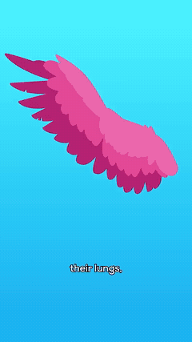
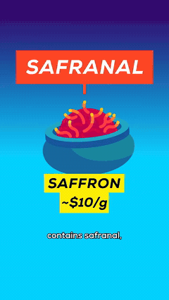
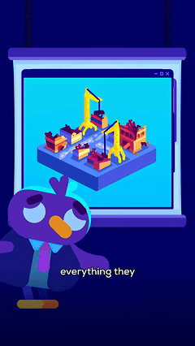
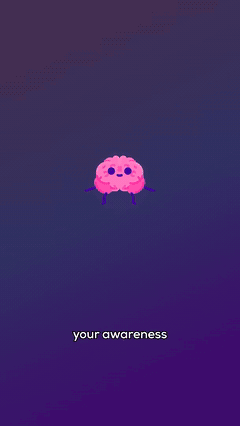
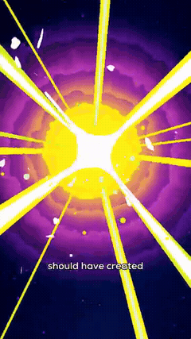
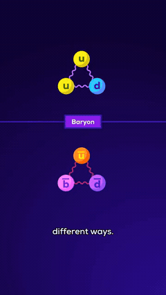
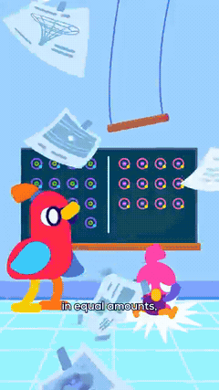
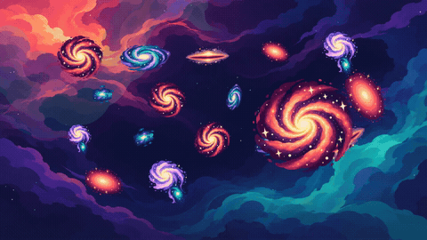
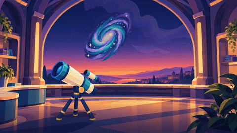

# Motion that carries one scene into the next

The user rejected the full singularity film: **zero creative checks passed**. This study addresses the first requested issue, transitions created by the animation itself. The target is a connected sequence of actions: an object, mechanism, graphic or effect already in motion carries attention into a new view, and the next action develops from it.

Eight user-uploaded reference clips were surveyed. **Twelve selected animated handoffs** have timestamped frame sheets and short silent loops. Five intervals also have **24 consecutive decoded source frames** each. Three ordinary cuts are included as controls. [Complete source hashes, decoded timestamps and film audit](study.json) · [Authored case descriptions](cases.json) · [All major joins in our rejected film](singularity-joins.csv)

These are observations of the supplied portrait videos, not a new review of full long-form YouTube episodes. YouTube returned proxy HTTP 403 on the current attempt; [access record](youtube-access.json). The earlier uploaded-source hashes were checked. Source filenames and timing are retained, so another reviewer can locate every example. Silent GIFs play at 25 fps, with artificial restarts; consecutive-frame sheets and JSON retain source timing. Sound design and private studio rig details are outside this evidence.

## 1. Carry a working action into its next explanation

| Wing → bellows → lungs | Saffron bowl → its effect on the brain |
|---|---|
|  |  |

**Could Humans Evolve Flight, 20.1–22.8 s.** The wing is already flapping. A bellows appears at the same working hinge, while the wing remains partly translucent. The pumping mechanism changes shape through the stroke. The bellows then moves left, a connecting tube spans the gap, and the lungs enter from the right. The handoff retains both the action and its explanatory function. The next composition is assembled by moving connected parts.

This is not evidence of a literal outline-to-outline morph: the footage visibly supports aligned local overlap/replacement. Its important feature is the continuing pumping action. Putting a crossfade between two motionless illustrations would lose that feature. [Consecutive wing/bellows frames](sheets/dense-bellows.jpg) · [Wider action sheet](sheets/wing-bellows-lungs.jpg)

**The Deadliest Thing in Your Kitchen, 30.1–32.1 s.** The bowl lifts and tilts as its labels retract. The anatomical head rises into the space below it. Falling specks then connect the bowl with the brain, whose expression changes. One prop's repositioning stages the entrance and consequence of the next subject; no camera move is needed to carry that explanation. [Source frames](sheets/saffron-brain.jpg)

**Application:** plan the outgoing subject's final action and the incoming subject's first response together. Draw the poses/deformation needed for that shared action. Entrance, contact, transfer and settling need separate timing; adding a sinusoidal float to two PNGs is insufficient.

## 2. Open an already animated detail into the next environment

| Rain inset → rainy world | Rebuilding projection → working model |
|---|---|
|  |  |

**Let's Steal a New Moon, 25.95–27.35 s.** The inset contains moving rain before it expands. Its border grows beyond the view; water occupies the lower part of the resulting environment, and the probe enters. Rain remains active during and after the change in framing. In the consecutive samples, the strong expansion is visible around **26.22–26.59 s**, roughly eleven source-frame intervals. This is a descriptive interval, not a universal transition duration. [24 consecutive frames](sheets/dense-rain.jpg)

**The True Cost of War, 9.35–10.6 s.** The construction model already exists on the projection screen. The model and turquoise field enlarge; the screen frame and presenter pass out of view. Construction activity continues as the model becomes the main explanation. Shared content prevents an arbitrary visual restart. [Source frames](sheets/projector-world.jpg)

**Application:** the detail must have a working miniature version before the handoff. Its moving contents continue as the surrounding mask opens. The incoming environment needs adequate resolution and separate moving rain/water/actors; a static preview enlarged to full frame would reproduce the presentation problem.

## 3. Let an active subject generate the changing field

| Brain → expanding effect field | Energy burst → matter/antimatter diagram |
|---|---|
|  |  |

**Your Brain on Magic Mushrooms, 24.15–25.65 s.** The brain remains identifiable, changes scale/expression, and a small colored effect appears around it. The effect expands rapidly to fill the frame, then the bands continue changing. The dense samples show the field growing from a small disc at approximately **24.62 s** to full coverage by approximately **24.86 s**. The expanding field begins at the existing focal subject. [24 consecutive frames](sheets/dense-field.jpg)

**Where Did the Antimatter Go_, 3.9–5.3 s.** The luminous burst grows into near/full white coverage, and the two-color matter/antimatter field emerges around the same central energy shape. Coverage is caused by the illustrated event. The source supports a luminous bridge; it does not establish the exact mask or compositing operation used. [Source frames](sheets/energy-cover.jpg)

**Application:** an effect needs an on-screen cause, a direction of growth and continued internal movement. Preserve the focal subject while coverage changes. Use this only where the narrated event supports it; routine bright flashes would become another repetitive preset.

## 4. Keep the subject alive while its context changes

| Diagram → monitor | Moving paper → particle explanation |
|---|---|
|  |  |

**Where Did the Antimatter Go_, 57.15–58.15 s.** The same upper/lower particle groups shrink into the monitor as the desk and scientist are revealed. The scientist settles at the screen. The principal scale/reveal change occupies roughly **57.43–57.70 s** in the dense samples. The diagram's identity and grouping survive the change of context. [24 consecutive frames](sheets/dense-monitor.jpg)

**The same clip, 44.35–49.2 s.** One paper separates from the falling clutter and remains bright while the room dims. It enlarges; its particle figure then becomes the colored diagram as the page recedes. Selective opacity is present, but a continuing moving subject organizes the transition. This example should not be reduced to a rule that all fades are bad. [Source frames](sheets/paper-diagram.jpg)

**Let's Steal a New Moon, 3.0–5.7 s.** The chosen Amalthea remains visible while title, building and other choices recede. It grows/repositions, then shrinks as Jupiter enters for the next comparison. The subject survives while the surrounding explanation is rebuilt. [Loop](loops/moon-selection.gif) · [Frames](sheets/moon-selection.jpg)

**Application:** identify one object that owns the handoff and keep its motion state across the join. Change surrounding actors, framing or diagram detail around it. A selective fade can support attention without substituting for the object's action.

## 5. Use enlargement to expose a new representation, with the right drawings

**Your Skeleton Is Electric, 5.65–7.1 s.** The fiber enlarges until its orange/yellow side fills the view, then elongated strands and charge symbols become the working detail. The consecutive samples include fiber coverage around **6.49–6.52 s** and the molecular view by approximately **6.56 s**. There is a representation change/cut; the footage does not prove a single continuous 3D model. [Loop](loops/collagen-through.gif) · [24 consecutive frames](sheets/dense-collagen.jpg)

**The same clip, 31.2–33.3 s.** The raised osteon enlarges into a closer view. Its concentric top becomes the cell-level network while the orange cylinder remains. The detail is changed locally on a subject that the viewer already recognizes. [Loop](loops/osteon-detail.gif) · [Frames](sheets/osteon-detail.jpg)

**Could Humans Evolve Flight, 32.3–34.1 s.** The green stem/bead shrinks toward the puppet's lower body while the larger puppet is revealed and starts articulating. Its continuity links the molecular control metaphor with the larger mechanism. [Loop](loops/molecule-puppet.gif) · [Frames](sheets/molecule-puppet.jpg)

**Application:** prepare the real close-up drawing and its animated mechanism. The outgoing object can conceal a necessary change of representation, but enlarging one raster painting throughout cannot supply the new anatomy, internal parts or movement.

## What our singularity cut actually does

The implementation has **23 major sections and 22 joins**. Every major join uses the same smooth opacity ramp across **11 frame intervals, approximately 0.367 s at 30 fps**. The outgoing `Stage` and backplate are repeatedly evaluated at `sectionStart - 1`, so their animation time stops while the incoming composition fades over them. This is directly visible in the encoded examples and in the [source at review](../../../src/Singularity.tsx). [Complete join audit](singularity-joins.csv)

| Our opening → star, around 6.10 s | Our observatory → gravity, around 113.77 s |
|---|---|
|  |  |

[Opening transition frames](sheets/our-opening-star.jpg) · [Observatory transition frames](sheets/our-observatory-gravity.jpg)

| Specific failure | Required change in the next transition test |
|---|---|
| Entire compositions overlap regardless of their subjects | Choose an existing moving object/action that introduces the next explanation. |
| Outgoing animation freezes during the overlap | Let both outgoing and incoming actors continue their authored actions through the shared interval. |
| Incoming object appears at a new position with no visual connection | Establish its entrance, trajectory, focal relationship and first interaction before removing the old context. |
| Backplates change independently of a meaningful action | Open/remove the environment through an object, field or explicitly staged reveal where the story supports it. |
| All major joins use one duration/curve | Time each action to Knox's phrase; separate preparation, transfer, reveal and settling. |
| Very long sections and repeated galaxy artwork remain underneath the transition treatment | These remain rejected issues. A transition revision alone cannot establish a pass for the film's scene animation or artwork. |

Encoding, sync and unchanged-asset hashes establish delivery properties. They do not establish animation quality. The original passed Mira/Sol drawing and medicine/cyber references remain available as baselines; the new singularity artwork, movement and transitions have not passed.

## A narrow brief for the next animation test

These are proposed original adaptations, not completed fixes or a claim that the reference contains these exact shots. Keep the user's Knox recording and all its timing/pitch unchanged. Test a few connected actions before re-rendering nine minutes.

| Narrated join | Continuing action and next view | Artwork/motion that must exist |
|---|---|---|
| Atom → hotter plasma, around 11.43 s | The atom is already breaking apart. The same electron leaves its orbit and the same nucleus continues along its trajectory into the denser particle field; surrounding gas deforms and neighboring particles become readable. | Separate nucleus/electron identities, authored paths, gas deformation and a working particle field. No need to replace the entire background at the join. |
| Incorrect room → expansion without an external container, around 193.40 s | The room walls withdraw/fold away while an already moving field becomes visible behind them. Distances continue changing through the removal, and the explicitly misleading-container framing resolves with the action. | Separate wall/floor/edge layers, coverage masks and a moving field staged before the reveal. No universal-center marker or implied external physical room. |
| Evidence at the telescope → human observer, around 488.97 s | Observation activity continues as the observer enters and responds; the instrument and sky retain their motion while the character assumes the explanatory role. | An actual instrument action, a matching character entrance/body pose sequence and grounded contacts. Reusing a standing figure with a slow scale change is insufficient. |

For each test, specify the persistent subject, start/end pose, screen path, changing silhouette, reveal boundary, local secondary action and final settle. In Remotion the persistent subject should share its state across the overlap rather than restart as unrelated copies. Keep backdrop/foreground masks separate from subject deformation. Inspect the join as moving footage, then inspect consecutive frames for jumps, double silhouettes, seams and frozen participants. Add the required pose/deformation artwork rather than trying to force every action out of one cutout.

The acceptance question is whether the viewer can follow one continuous action into the next explanation. These examples guide construction; they confer no automatic pass on a new test.

## Controls: similar pictures do not prove a motion handoff

The baby scene → neuron diagram in **Your Brain Peaked at Birth, around 16.2 s**, Io → volcanic surface in **Let's Steal a New Moon, around 40.4 s**, and explosion → kitchen in **The Deadliest Thing in Your Kitchen, around 62.3 s**, are direct view changes in the sampled boundaries. They are not cited as continuous morphs, zooms or wipes. Their existence does not change the focus of this study: animated actions that actively connect explanations.

[Baby/neuron frames](sheets/control-baby-neuron.jpg) · [Io/volcano frames](sheets/control-io-volcano.jpg) · [Explosion/kitchen frames](sheets/control-explosion-kitchen.jpg)

## Reproduce

```sh
python -m pip install --target .cache/motion-study -r references/requirements-motion.txt
python scripts/study_reference_transitions.py --source-root /workspace/attachments
```

The eight recorded source filenames must be available under that root. The script verifies source hashes, builds all eight survey sheets, twelve silent excerpts, fifteen sampled case/control sheets, five consecutive-frame sheets and two encoded-film comparisons. It writes only this study directory. Production artwork, the narration and the rejected movie are left unchanged. Use `--skip-film` to rebuild reference evidence after production source has changed from the rejected implementation. [Survey/source index](study.json)
